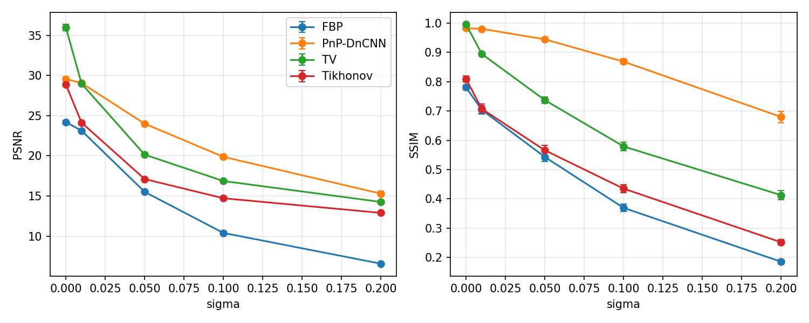
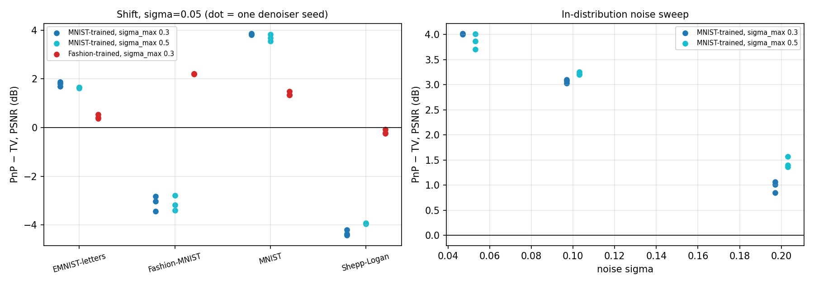
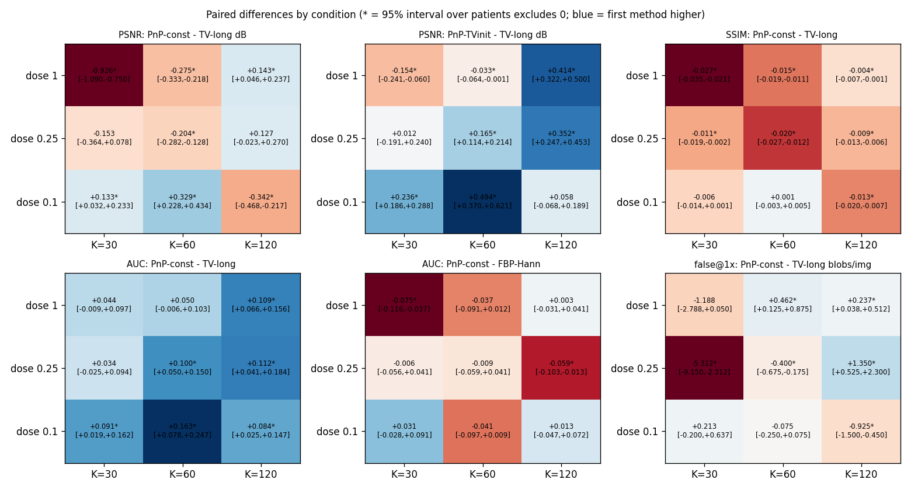

# Learned Regularization for Robust Image Reconstruction

[](LICENSE)

A controlled study of when a **learned image prior** helps sparse-view CT reconstruction, and when it does not.
A noise-conditioned DnCNN denoiser is used as a Plug-and-Play (PnP) prior inside proximal gradient and compared with
FBP, Tikhonov and total-variation (TV) regularization under noise, undersampling, forward-model error, distribution
shift and a lesion-detection task, first on 28x28 digit images and then on real clinical-size CT slices (LoDoPaB-CT).

- **Paper:** [paper/Learned_Regularization.pdf](paper/Learned_Regularization.pdf) (source: `paper/main.tex`). Preprint link: *to be added*.
- **Full write-up of every experiment:** [REPORT.md](REPORT.md).
- **Everything is reproducible from this repository:** code, trained models, raw per-image results and figure scripts.

> **One-sentence result.** The learned prior is about 3.4 dB better than a box-constrained TV on 28x28 digits at moderate noise,
> but the advantage reverses under distribution shift, disappears on real CT slices, and PSNR does not predict
> lesion detectability, in either direction.

## Contents

1. [Questions and short answers](#questions-and-short-answers)
2. [Main results](#main-results)
3. [How to read the numbers](#how-to-read-the-numbers)
4. [Method in brief](#method-in-brief)
5. [The 19 experiments](#the-19-experiments)
6. [Repository structure](#repository-structure)
7. [Setup and data](#setup-and-data)
8. [Reproducing the results](#reproducing-the-results)
9. [Limitations](#limitations)
10. [Citation and contact](#citation-and-contact)

## Questions and short answers

| Question | Short answer |
|---|---|
| **Q1. Does the learned prior keep its advantage over TV when the image distribution changes?** | **No, not in accuracy.** An MNIST-trained prior is 3.1 dB (Fashion-MNIST) and 4.3 dB (Shepp-Logan phantom) *below* TV. A prior trained on Fashion-MNIST beats TV on Fashion-MNIST by 2.2 dB, so the reversal is prior mismatch, not a failure of PnP itself. On real CT the detection advantage is kept in 1 of 6 shift conditions (3 of 6 in distribution) and the PSNR and SSIM deficit against TV grows. |
| **Q2. Can the method create convincing but incorrect structures?** | **Yes, in some regimes.** Under prior mismatch it produces 0.20-0.66 lesion-like blobs per image (more than TV on 7 of 8 lesion types, even against a box-constrained TV). In distribution on digits it produces almost none but *erases* inserted lesions. On real slices it makes fewer blobs than FBP-Hann, and its largest false blobs coincide with those of FBP and TV. On phantoms at quarter dose it adds a few per phantom relative to FBP-Hann. |
| **Q3. Do the conclusions hold across noise levels and conditions?** | **Only partly.** The advantage is largest at moderate noise and shrinks at both ends; the near noise-free ranking depends on how the data are simulated. On CT, the sign of PSNR, SSIM and false-blob differences changes with dose and angle count. Only the sign of the detection advantage over a PSNR-tuned TV is the same in all 9 conditions (significant in 6). |

## Main results

### 28x28 digits (Stages 1-2)

PnP minus TV, PSNR in dB at sigma = 0.05 and 20 angles, three independently trained denoisers per prior (mean +- s.d.); crime-free data,
every method tuned on its own prior's validation set. "TV-box" is TV with the constraint 0 <= x <= 1.

| Test set | MNIST-trained prior vs TV-ADMM | vs TV-box | Fashion-trained prior vs TV-ADMM | vs TV-box |
|---|---|---|---|---|
| MNIST | **+3.84 +- 0.03** | +3.36 | +1.38 +- 0.09 | +1.44 |
| EMNIST letters | +1.79 +- 0.09 | +1.72 | +0.44 +- 0.09 | +0.38 |
| Fashion-MNIST | **-3.10 +- 0.30** | -3.13 | **+2.21 +- 0.01** | +2.17 |
| Shepp-Logan | **-4.33 +- 0.12** | -4.55 | -0.18 +- 0.08 | -0.05 |



Other findings on digits:

- **Early stopping is regularization.** PSNR peaks after about 5 iterations and then degrades while the data residual stays at the noise level;
  74% of the error growth lies in directions with 0.1 <= s_i/s_1 < 0.3. We read this as semi-convergence (a hypothesis, not tested).
- **Most of the excess error under shift is in the well-determined directions** (93% on Fashion-MNIST, 89% on the phantom), so "null-space hallucination" is an incomplete description.
- **Evaluation protocol matters.** The inverse crime changes the low-noise gap by up to 5.5 dB; the seed changes the Fashion-MNIST gap between -2.83 and -3.43 dB.
- **PSNR is not task performance.** In distribution the PnP reconstruction is about 4 dB better than TV yet its paired lesion-detection AUC is 0.04-0.23 *below* TV, because it attenuates lesions.
  Re-tuning trades erasure against invention; for the broader Fashion-trained prior a competitive operating point exists, for the MNIST-trained prior it does not.
- **Poisson noise and a matrix-free operator do not change the picture** (gain peaks at moderate dose, reversal under shift persists, lesion results similar).



### Real CT: LoDoPaB-CT (Stage 3)

362x362 slices, patient-disjoint split, 30/60/120 of 1000 angles, doses 1, 0.25 and 0.1 of 4096 photons per ray, 40 test patients, exact Poisson dose thinning.
TV is box-constrained; "TV-long" is TV with twice the iterations and its own tuned weight (the same iteration budget as PnP).

| | Result |
|---|---|
| **Accuracy** | PnP-const minus TV-long is -0.93 to +0.33 dB over 9 conditions (3 significantly positive, 4 significantly negative); SSIM lower in 8 of 9 (7 significant). The best variant (PnP started from the TV solution) is highest in 7 of 9 by at most 0.49 dB, but those variants were introduced after the first result, and at K=120 full dose its gain is not from the denoiser. |
| **Detection of small lesions** | PnP-const beats TV-long in all 9 conditions (AUC +0.03 to +0.16, 6 significant) but never significantly beats plain FBP-Hann. The PSNR-tuned TV-long is worse than FBP-Hann at detection in all 9 (7 significant) while gaining 0.8-2.3 dB in PSNR. |
| **False structures** | 0.24-1.38 false blobs per slice for PnP-const, fewer than FBP-Hann in every condition examined. The strongest blobs appear at the same place in FBP and TV: they come from the data. |
| **Shift to non-anatomical phantoms** | PSNR below TV-long in all 6 conditions (5 significant), SSIM in all 4. Detection advantage kept in 1 of 6. False-blob counts relative to TV change sign with the number of angles. This shift is deliberately TV-friendly (piecewise-constant phantoms). |



**Reading across stages.** The "+3.4 dB over TV" belongs to 28x28 digits with a matched prior and does not carry over to clinical-size CT.
The sign of the detection difference is reversed between digits (PnP worse than TV) and CT (PnP better than TV-long); we report it and did not isolate the cause.

## How to read the numbers

- **Which TV?** TV-ADMM is the unconstrained baseline of the early experiments; TV-box is the box-constrained control (Chambolle-Pock, 0 <= x <= 1). Stage 3 TV is always box-constrained.
  The control was run for E1-E2, E4, E6 (bicubic data), E8 and E9; the other digit experiments (E3, E5, E7, E10, E12-E13) use TV-ADMM only. In the Gaussian MNIST case the box constraint lowers the gap by about 0.5 dB.
- **Statistics.** Digits: mean +- 1.96 s.e., paired Wilcoxon tests, bootstrap intervals. Real CT: paired differences with 95% percentile bootstrap intervals over patients.
  No multiplicity correction anywhere; read sign patterns across conditions, not single intervals.
- **History of the analysis.** Parts of the Stage 3 analysis were developed after seeing results, and an early K=60 comparison (PnP 0.85 dB below TV) shrank to 0.17 dB after re-tuning on 20 instead of 6 validation slices.
  See "Analysis history" in the paper and REPORT.md. Nothing was pre-registered.
- **No reader study.** "Convincing" means a lesion-like response of the observer statistic at the kernel scale.

## Method in brief

Sparse-view CT is the linear inverse problem `y = A x + n`. PnP proximal gradient iterates

```
x_{k+1} = D_sigma_d( x_k - eta * A^T (A x_k - y) ),    eta = 1 / L(A^T A)
```

where `D_sigma_d` is a noise-conditioned DnCNN, trained once (on MNIST for digits, on LoDoPaB slices for CT). The early iteration count `k` and `sigma_d` are tuned like every other hyperparameter.

- **Operators.** Digits: a dense Radon matrix (800x784 at 20 angles); Stages 2-3: a matrix-free projector with an exact adjoint, validated against the dense one (relative agreement better than 3e-4).
- **Data.** Inverse-crime data (generated with the reconstruction operator) and crime-free data (bicubic fine grid, factor 5, plus nearest/bilinear variants); Gaussian noise (Stage 1) and Beer-Lambert Poisson noise (Stages 2-3).
- **Baselines.** FBP (Hann for CT), Tikhonov, TV-ADMM, TV-box (primal-dual).
- **Protocol.** Disjoint train/validation/test splits (patient-disjoint on CT); every method tuned by grid search on validation data, then frozen for the shift and mismatch experiments.
- **Error decomposition.** Errors are split along the singular vectors of `A` into well-determined and weakly determined (including the exact null space) subspaces.
- **Lesion test.** A known Gaussian lesion is inserted at a known location; lesion-present and lesion-absent images are reconstructed from independent noise draws. Paired AUC, lesion retention and false lesion-like blobs are reported.

## The 19 experiments

| # | Question | Main script(s) | Key outputs (`results/`) |
|---|---|---|---|
| E1-E2 | In-distribution accuracy vs noise and undersampling | `run_baselines.py`, `run_pnp.py`, `make_plots.py`, `make_figures.py` | `comparison_*.png`, `baselines_*.csv` |
| E3 | Forward-model mismatch (angle offset and jitter) | `run_robustness.py --exp mismatch`, `run_e3_rotation_check.py` | `robust_mismatch.png`, `control/e3_offset_rotation.csv` |
| E4 | Distribution shift | `run_robustness.py --exp shift` | `robust_shift.png`, `fig_shift_grid.png` |
| E5 | Why PnP selects few iterations | `run_spectral.py`, `make_fig_e5_iterations.py` | `iteration_control*.csv`, `spectral_bands.csv` |
| E6 | Sensitivity to the inverse crime | `run_nullspace.py --fine_factor 5 --up_mode bicubic`, `compare_crime.py` | `crime_comparison.csv/.png` |
| E7 | Error decomposition along singular vectors | `run_nullspace.py` | `nullspace_*.csv`, `nullspace_signature*.png` |
| E8 | Denoiser seeds and matched-prior control | `run_step4.py`, `summarize_step4.py`, `run_tv_box_shift.py` | `step4/`, `control/tv_box_shift_seeds.csv` |
| E9 | Lesion insertion | `run_lesions.py`, `summarize_step5.py`, `run_tv_box_lesions.py` | `step5/`, `control/tv_box_lesions_*.csv` |
| E10 | Can re-tuning recover lesion detectability? | `run_oppoint.py` | `step5b/oppoint_*.csv/.png` |
| E11 | Matrix-free operator reproduces the dense pipeline | `run_stage2.py --exp equiv`, `run_e11_svd_check.py` | console, `control/e11_svd_check.csv` |
| E12 | Poisson dose sweep | `run_stage2.py --exp dose` | `stage2/dose_sweep.csv/.png` |
| E13 | Lesion insertion under Poisson noise | `run_lesions_poisson.py` | `stage2/lesions_I100/`, `stage2/lesions_I30/` |
| E14 | Real data, noise model and simulator check | `run_stage3_step1.py`, `run_stage3_step2.py` | `stage3/noise_check.json`, `geometry_check.png` |
| E15 | Learned prior vs TV on real slices, K = 60 | `run_stage3_step3b.py` | `stage3/step3b_*.csv` |
| E16 | Accuracy over the dose x angle grid | `run_stage3_step5.py`, `run_stage3_step5_summary.py` | `stage3/s5/step5_*.csv`, `step5_grid.png` |
| E17 | Lesion detection on real slices | `run_stage3_step5.py`, `run_stage3_step4*.py` | `stage3/s5/`, `stage3/s4c/` |
| E18 | False structures on real slices | `run_stage3_step4b.py --gallery 1` | `stage3/step4b_gallery_*.png` |
| E19 | Shift to non-anatomical phantoms | `run_stage3_step5_shift*.py`, `run_e19_k60_psnr_ci.py` | `stage3/s5/shift/`, `control/e19_k60_psnr_ci.csv` |

## Repository structure

```
src/
  operators.py      dense sparse-view Radon operator (exact adjoint, angle mismatch)
  radon_mf.py       matrix-free projector, exact adjoint, FBP
  radon_pb.py       matrix-free parallel-beam operator for LoDoPaB geometry (362x362 images, 513 detector bins)
  baselines.py      Tikhonov (closed form) and TV-ADMM
  tv_pdhg.py        box-constrained TV (Chambolle-Pock)
  mf_solvers.py     CG Tikhonov, TV-ADMM, Poisson sinograms, randomized SVD, strong/weak error split
  mf_tune.py        tuning and reconstruction with the matrix-free operator
  denoiser.py       noise-conditioned DnCNN
  pnp.py, pnp_ct.py PnP solvers (digits, CT; constant / annealed sigma_d)
  finegrid.py       crime-free data simulation (finer grid)
  nullspace.py      singular-vector error decomposition
  lesions.py        lesion insertion and observer (digits)
  lesions_ct.py     lesion insertion and observer (CT), false blobs, paired statistics
  oppoint.py        operating-point study
  lodopab.py        LoDoPaB-CT data access (zip files, patient ids)
  lodopab_noise.py  Poisson photon-count noise model of the observations
  ct_sim.py         crime-free CT simulation (x2 upsampled projection, Poisson noise)
  phantoms.py       non-anatomical phantoms for the shift test
  tune_ct.py        per-condition tuning of Hann, TV, TV-long, PnP-const and PnP-TVinit
  experiment.py, metrics.py, data.py                                   shared helpers, PSNR/SSIM, dataset loaders
train_denoiser.py, train_denoiser_ct.py    train the digit prior (MNIST) and the CT prior (LoDoPaB)
run_*.py, summarize_*.py, make_*.py        experiment, summary and figure scripts (table above)
tests/               68 tests: python -m pytest tests -q
results/             CSVs, PNGs and summary tables (generated; control outputs in results/control/)
paper/               main.tex, references.bib, figures, compiled PDF
REPORT.md            complete write-up of every experiment and caveat
```

## Setup and data

```
pip install -r requirements.txt       # numpy, scipy, scikit-image, torch, torchvision, matplotlib, pandas
pip install h5py                      # Stage 3 only
```

Tested with Python 3 and torch 2.5.1 (CUDA 12.1) on Windows with an NVIDIA RTX 3050 Ti (4 GB); a CPU is enough for Stage 1 but slow for the rest.

- **Digits:** MNIST, Fashion-MNIST and EMNIST letters are downloaded by `torchvision` into `data/`.
- **Real CT:** download the LoDoPaB-CT zip files (Leuschner et al., *Scientific Data*, 2021) into `data/` and run
  `python run_stage3_step1.py --root data --extract`.
- **No download needed for a smoke test:** `python run_baselines.py --exp noise --synthetic --n_val 30 --n_test 50`.

## Reproducing the results

Run all commands from the repository root. Most scripts are resumable and print their outputs.

**Stage 1 (digits, minutes on a GPU)**

```
python train_denoiser.py --epochs 8
python run_baselines.py --exp noise && python run_baselines.py --exp angles
python run_pnp.py --exp noise && python run_pnp.py --exp angles
python make_plots.py --exp noise && python make_plots.py --exp angles
python run_robustness.py --exp mismatch && python run_robustness.py --exp shift
python make_figures.py && python make_summary.py
```

**Stage 1 extensions** (E5-E10): `run_nullspace.py [--fine_factor 5 --up_mode bicubic --suffix _fine5c]`, `compare_crime.py --suffix _fine5c`,
`run_spectral.py`, `run_step4.py` + `summarize_step4.py`, `run_lesions.py` + `summarize_step5.py`, `run_oppoint.py`. Each script's docstring lists its arguments and outputs.

**Stage 2** (E11-E13): `run_stage2.py --exp equiv`, `run_stage2.py --exp dose`,
`run_lesions_poisson.py --I0 100 --out results/stage2/lesions_I100` (and `--I0 30`), then `summarize_step5.py --dir results/stage2/lesions_I100`.

**Stage 3** (E14-E19; the dose x angle grid takes hours on a 4 GB GPU and is resumable):

```
python run_stage3_step1.py --root data
python run_stage3_step2.py --exp noise
python run_stage3_step2.py --exp baselines --angles 60 --doses 1,0.25 --n_val 6 --n_test 40
python run_stage3_step2.py --extract_train 70
python train_denoiser_ct.py                       # add --depth 17 --steps 20000 for the deeper denoiser
python run_stage3_step3b.py --models results/stage3/dncnn_ct.pt,results/stage3/dncnn_ct_d17.pt --doses 1,0.25
python run_stage3_step4.py --doses 1 --out results/stage3/s4c --n_val 20 --auto_extend 2 ...   # full arguments: REPORT.md
python run_stage3_step4b.py --doses 1 --out results/stage3/s4c --gallery 1
python run_stage3_step4c_compare.py
python run_stage3_step5.py && python run_stage3_step5_summary.py
python run_stage3_step5_shift.py && python run_stage3_step5_shift_summary.py
```

`run_stage3_step3.py` is the superseded first comparison, kept for the record; its numbers are not used.

**Controls added during the paper review** (outputs in `results/control/`):

```
python run_tv_box_control.py --data fine5c        # box-constrained TV for E1-E2
python run_tv_box_shift.py                        # E4, E8 (MNIST- and Fashion-trained families)
python run_tv_box_lesions.py                      # E9
python run_e3_rotation_check.py                   # E3: offset equals rotation
python run_e11_svd_check.py                       # E11: randomized vs dense SVD, error split
python run_e19_k60_psnr_ci.py                     # E19: K=60 PSNR intervals
python make_fig_e1e2_gap.py && python make_fig_e5_iterations.py   # figures drawn from stored results
```

**Tests and paper**

```
python -m pytest tests -q                         # 68 tests
cd paper && pdflatex main && bibtex main && pdflatex main && pdflatex main
```

## Limitations

The study is deliberately small and conditional, and the paper's Limitations section lists every caveat. The main ones:

- One architecture (DnCNN in PnP-PGD, no convergence guarantee), two training distributions on digits, and one CT training set and run (8,960 of 35,820 slices). Conclusions about "learned priors" in general are not warranted.
- 28x28 digits for the thorough grid; CT uses only 40 test patients with one noise realisation per condition (AUC uncertainty about +-0.05 per cell) and no multiplicity correction.
- TV-box was not run for every digit experiment, and the TV weight grid on CT has steps of a factor three.
- Lesions are additive Gaussian blobs with a location-known observer; there was no reader study, and clinically low-contrast lesions were not tested.
- The CT simulator was validated on 8 slices for the TV baseline only; the phantom shift is a single, TV-friendly kind of shift.

## Citation and contact

If you use this work, please cite the preprint (link to be added):

```
@misc{aboOraig2026learned,
  title  = {<title of the paper, as in main.tex>},
  author = {Abo Oraig, Mohammed},
  year   = {2026},
  note   = {Preprint}
}
```

Author: Mohammed Abo Oraig (independent research). Questions and issues: please open a GitHub issue.
