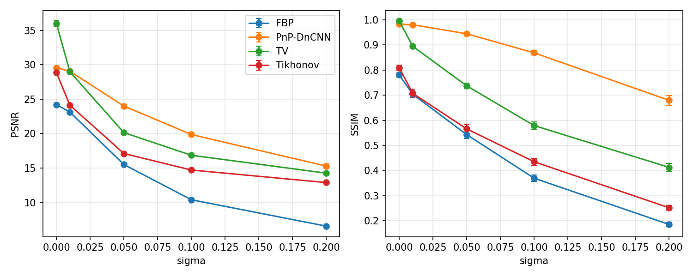
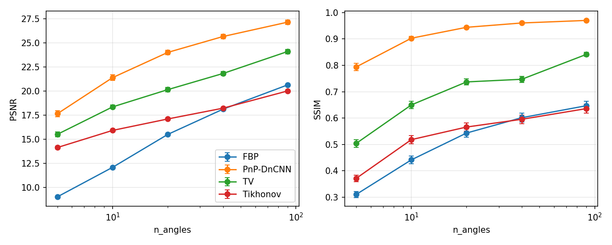
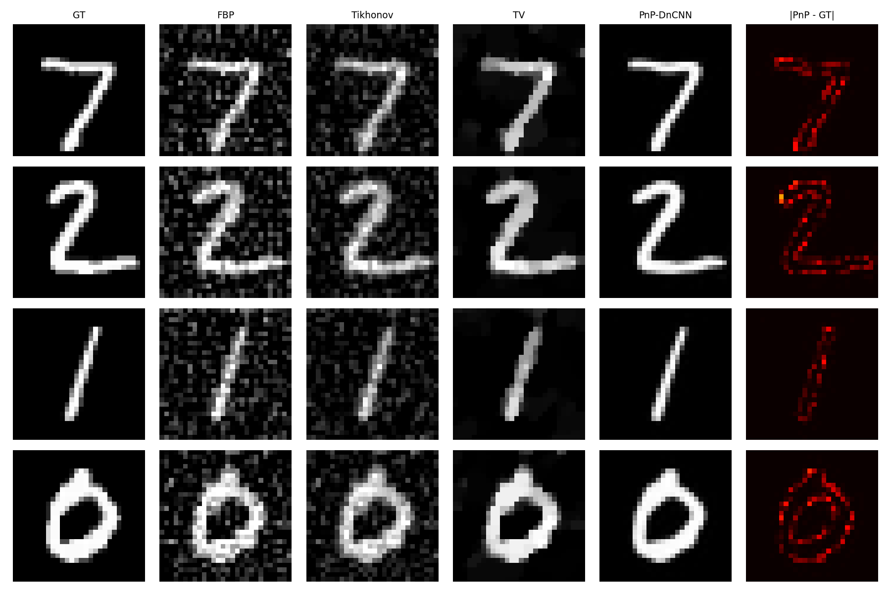
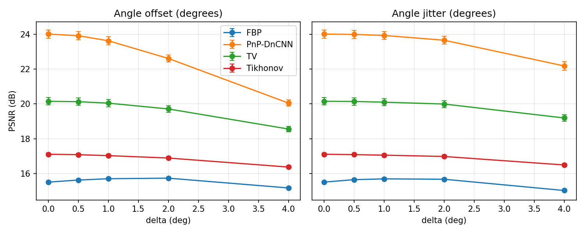
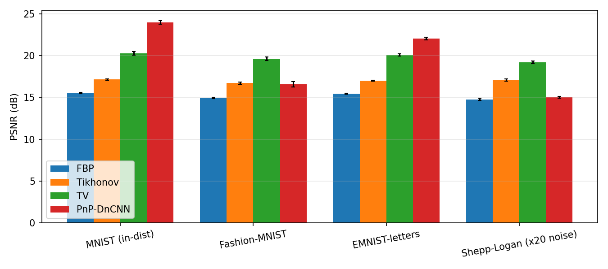

# Learned Regularization for Robust Image Reconstruction
### Sparse-view CT reconstruction with a Plug-and-Play learned prior

## 1. Problem and methods

We study sparse-view computed tomography as a linear inverse problem
y = A x + n, where A is a sparse-angle Radon transform (few projection
angles), x is a 28x28 image, and n is additive Gaussian noise. A is
formed explicitly as a dense matrix, giving an exact adjoint A^T, which
is used both for the classical solvers below and for the learned
proximal-gradient scheme.

**Baselines (classical regularization):**
- Filtered back-projection (FBP)
- Tikhonov / L2 regularization (closed form)
- Total variation (TV), solved with ADMM

**Learned prior:** a noise-level-conditioned DnCNN denoiser D_sigma,
trained once on clean MNIST digits with Gaussian noise sigma in
[0, 0.3], used as an implicit prior inside a Plug-and-Play
proximal-gradient (PnP-PGD) iteration:

    x_{k+1} = D_{sigma_d}( x_k - eta * A^T(A x_k - y) ),   eta = 1 / L(A^T A)

All hyperparameters (Tikhonov lambda, TV lambda, PnP sigma_d and number
of iterations) are tuned by grid search on a held-out validation split,
separately for each experimental condition unless stated otherwise, and
then evaluated on a disjoint test split. Metrics are PSNR and SSIM,
reported as mean and 95% CI over test images, plus a paired Wilcoxon
signed-rank test between PnP and TV on matched images and noise
realizations.

### Method
- `MatrixFreeRadon` never forms A: embed the 28x28 image in a 40x40 canvas, rotate by each angle (bilinear, about the pixel used by skimage), sum along detector rows. The adjoint is the exact transpose, obtained by autograd. Tikhonov and TV use conjugate gradients; subspaces use a randomized SVD (forward and adjoint products only).
- Poisson model: counts N ~ Poisson(I0 exp(-mu * A x)), data = -log(max(N,1)/I0)/mu, mu = 2. Data are generated on the finer grid (bicubic, factor 5). I0 = 1000, 300, 100, 30, 10 gives an effective sinogram noise std of 0.018, 0.032, 0.056, 0.106, 0.198. Hyperparameters are tuned per dose on 100 held-out validation images and frozen for all test sets.

## 2. In-distribution accuracy (E1: noise, E2: angles)

TV is a strong baseline on MNIST because digits are close to piecewise
constant. PnP overtakes it as soon as the problem is genuinely
ill-posed:

| Condition | FBP | Tikhonov | TV | PnP-DnCNN | PnP - TV |
|---|---|---|---|---|---|
| sigma=0, 20 angles | 24.2 | 28.9 | **36.0** | 29.6 | -6.4 dB |
| sigma=0.01, 20 angles | 23.1 | 24.1 | 29.0 | 29.1 | +0.07 dB (n.s., p=0.27) |
| sigma=0.05, 20 angles | 15.5 | 17.1 | 20.2 | **24.0** | +3.85 dB (p<1e-30) |
| sigma=0.1, 20 angles | 10.4 | 14.7 | 16.9 | **19.9** | +3.0 dB (p<1e-30) |
| sigma=0.2, 20 angles | 6.6 | 12.9 | 14.3 | **15.3** | +1.0 dB (p<1e-10) |
| 5 angles, sigma=0.05 | 9.1 | 14.2 | 15.5 | **17.7** | +2.15 dB (p<1e-25) |
| 90 angles, sigma=0.05 | 20.6 | 20.0 | 24.1 | **27.1** | +3.04 dB (p<1e-30) |

(PSNR in dB, test set, best hyperparameters per method and condition.
Full grid in `results/summary_table.md`; all values reproducible via
`run_baselines.py`, `run_pnp.py`, `make_plots.py`.)

**Finding 1.** The learned prior gives a large, statistically
significant improvement over TV whenever the problem is genuinely
under-determined or noisy (few angles, or sigma >= 0.05): up to +4 dB
PSNR and a jump in SSIM from ~0.74 to ~0.94 at sigma=0.05. In the
near-noiseless, well-posed regime TV wins clearly (-6.4 dB), because
its assumption (piecewise-constant images) is closer to exact for
MNIST digits than the CNN prior's implicit assumption.

**Figure: PSNR and SSIM vs. measurement noise (20 angles).** TV leads
at low noise (sigma <= 0.01); PnP-DnCNN overtakes all classical
baselines from sigma = 0.05 upward. Error bars: 95% CI over 200 test
images.

**Figure: PSNR and SSIM vs. number of projection angles (sigma=0.05).**
PnP-DnCNN leads across the entire range tested, with the largest
relative advantage under the most severe angular undersampling (5
angles). Error bars: 95% CI over 200 test images.

**Figure: Qualitative reconstructions (sigma=0.05, 20 angles).** Rows
are individual test digits; columns show ground truth, the three
classical baselines, PnP-DnCNN, and the absolute error map for
PnP-DnCNN. FBP and Tikhonov retain visible noise; TV looks blocky;
PnP-DnCNN is visually closest to the ground truth. Error is
concentrated on stroke edges, not flat regions.

## 3. Forward-model mismatch (E3)

Data are generated with the true 20-angle operator; reconstruction
uses a wrong operator with either a constant angle offset (rigid
mis-registration) or per-angle random jitter, up to 4 degrees.
Hyperparameters are frozen at their nominal (sigma=0.05, 20-angle)
values, not re-tuned per mismatch level.

- Under a 4-degree constant offset, PnP loses 4.0 dB (24.0 -> 20.0)
  while TV loses only 1.6 dB (20.2 -> 18.6). PnP's advantage over TV
  shrinks from +3.85 dB to +1.48 dB, but never disappears in this range.
- Under random per-angle jitter of the same magnitude, both methods
  degrade less (PnP: 24.0 -> 22.2; TV: 20.2 -> 19.2), and PnP remains
  clearly ahead.

**Figure: PSNR vs. angular error under forward-model mismatch**
(left: constant offset; right: per-angle jitter). Hyperparameters are
frozen at their delta=0 values. PnP-DnCNN stays ahead of all classical
baselines throughout, but loses ground faster than TV as the offset
grows, with its margin over TV shrinking from +3.85 dB at delta=0 to
+1.48 dB at delta=4 degrees. Error bars: 95% CI over 200 test images.

**Finding 3.** The learned prior is more sensitive to systematic
(rigid) forward-model error than TV is, even though it remains more
accurate in absolute terms over the tested range. A plausible
explanation is that PnP produces sharper, more confidently-placed
edges, which are penalized more by geometric misregistration than a
smoother TV reconstruction; this is a hypothesis, not something
independently verified here.

## 4. Distribution shift (E4)

The denoiser is trained only on MNIST digits. At test time the same
frozen pipeline (sigma=0.05, 20 angles) is applied to Fashion-MNIST,
EMNIST letters, and the Shepp-Logan phantom (single image, 20 noise
draws).

| Test set | TV | PnP-DnCNN | PnP - TV |
|---|---|---|---|
| MNIST (in-distribution) | 20.3 | **24.0** | +3.7 dB |
| EMNIST letters (near-shift) | 20.1 | **22.0** | +1.9 dB |
| Fashion-MNIST (far-shift) | **19.6** | 16.5 | -3.1 dB |
| Shepp-Logan phantom (far-shift) | **19.2** | 15.0 | -4.2 dB |

**Figure: PSNR under train-test distribution shift**, frozen pipeline
(sigma=0.05, 20 angles). PnP-DnCNN leads on MNIST (in-distribution)
and EMNIST (near-shift), but drops below TV and Tikhonov on Fashion-MNIST and the Shepp-Logan phantom (far-shift); it stays above FBP on Fashion-MNIST (16.6 vs 14.9 dB) and only marginally on the phantom (15.0 vs 14.8 dB). TV is the most
consistent method across all four sets. Note: the Shepp-Logan error
bar reflects noise-draw variation on a single image, not image-to-image
variation like the other three bars.

**Finding 4.** The prior generalizes to EMNIST letters, which share
digits' stroke-like statistics, but fails on Fashion-MNIST and the
Shepp-Logan phantom, both structurally unlike digits. `fig_shift_grid.png`
shows *how* it fails: not as generic blur, but as hallucinated
digit/stroke-like structure imposed on shoe textures and on the
phantom's interior, which is a more concerning failure mode than
graceful degradation, since the output can look confidently
structured while being wrong. This is the central limitation of the
project and the main argument for out-of-distribution testing of any
learned prior before deployment.

## 5. Why so few PnP iterations? (E5 ablation)

Validation tuning consistently selects very few PnP iterations
(5-25 for >= 10 angles and sigma <= 0.2; 100-400 for the 5-angle condition).
 The convergence study (`fig_convergence.png`, 50 test images, sigma_d in {0.02, 0.05, 0.1, 0.2},
400 iterations) shows why: PSNR rises quickly, **peaks around iteration
5-15, and then decays to a lower plateau** (e.g. sigma_d=0.1: peak
~24.0 dB near iteration ~10, plateau ~22.0 dB by iteration 400).
Simultaneously the data-fidelity residual ||A x_k - y|| does *not*
decrease with iteration; it rises and plateaus, more so for larger
sigma_d.

**Finding 2.** This PnP-PGD scheme does not converge to a fixed point
that is both data-consistent and maximally accurate. The CNN denoiser
has no non-expansiveness guarantee, so continued iteration trades data
fidelity for an increasingly strong (and increasingly biased) prior
pull. Early stopping is therefore not a tuning artifact but a
necessary, active part of the regularization; this is consistent with
know limitations of PnP methods using unconstrained deep denoisers
(Ryu et al. 2019 and related PnP-convergence literature discuss this
trade-off explicitly).

## 6. Inverse crime (E6)
Measurements are also simulated on a 5x finer grid (nearest / bicubic / bilinear object). For sigma >= 0.05 the
PnP-TV gaps change by <= 0.3 dB (bicubic) so E1-E2 are unaffected. At sigma <= 0.01 the gap depends on the model
mismatch: sigma=0: -6.43 (crime), -5.86 (nearest), -3.29 (bicubic), -0.97 dB (bilinear); sigma=0.01: +0.07, +0.16,
+1.02, +1.76 dB. TV stays ahead at sigma=0 in every variant. The out-of-distribution deficits persist (Fashion
-2.8 to -3.9 dB, Shepp-Logan -4.2 to -5.4 dB).

## 7. Error decomposition (E7)
Subspace W of right singular vectors with s < 0.05 s_max (319 of 784 dims at 20 angles). In distribution PnP/TV error
ratio is 0.48 in W and 0.40 outside W (alignment 0.76 vs 0.45). On Shepp-Logan PnP places 3.3x the true energy in W
(TV 0.44) with alignment 0.23; on Fashion-MNIST the ratios are 1.27 (W) and 2.32 (outside W).

## 8. Seeds and matched prior (E8)
Seed-to-seed s.d. <= 0.3 dB. MNIST prior vs TV: MNIST +3.84 +/- 0.03, EMNIST +1.79 +/- 0.09, Fashion -3.10 +/- 0.30,
Shepp-Logan -4.33 +/- 0.12 dB. Fashion-trained prior: Fashion +2.21 +/- 0.01, MNIST +1.38, EMNIST +0.44, Shepp-Logan
-0.18 dB. The reversal is a prior-mismatch effect, not a PnP failure. sigma_max 0.5 does not change the shift results;
at sigma=0.2 the tuned sigma_d is 0.3 for all six MNIST denoisers (not a grid-edge artefact).

## 9. Lesion insertion (E9)
Paired AUC of PnP is below TV's in every condition except for the largest high-contrast lesion (e.g. 0.69 vs 0.91 for a
0.75 px, contrast 0.5 lesion, MNIST prior on MNIST). In distribution PnP attenuates lesions (retention 0.12-0.78 vs
0.29-0.88 for TV) and produces <= 0.01 false lesions/image; under prior mismatch (MNIST prior on Fashion) lesions survive
(retention 0.78-1.04) but 0.20-0.66 false lesions/image appear (TV <= 0.20; matched prior <= 0.01).

## 10. Operating points (E10)
Re-tuning PnP towards lesion fidelity recovers TV-level detection only by giving up its PSNR advantage or by
raising false lesions: MNIST prior in distribution, constrained point +0.7 dB over TV with paired AUC -0.06 and 12x TV's
false-lesion rate; lesion-tuned point 0.5 dB below TV with 60x its false-lesion rate. With a matched Fashion prior the
constrained point keeps +1.0 dB over TV with AUC within 0.02-0.03 of TV's. Under shift, operating points chosen in
distribution do not protect (2.1-2.8 dB below TV, 0.40-0.51 false lesions/image).

## 11. Equivalence with the dense pipeline (200 images, GPU) (E11)
 
| Method | rel. difference | PSNR | time dense (s) | time matrix-free (s) |
|---|---|---|---|---|
| Tikhonov | 4.6e-6 | 16.36 | 0.08 | 0.26 |
| TV-ADMM | 9.7e-6 | 19.01 | 0.16 | 7.50 |
| PnP (k=25) | 2.8e-4 | 23.10 | 0.76 | 0.94 |
 
Forward difference 2.9e-7; peak GPU memory 184 MB. The randomized SVD finds the same 465-dimensional strong subspace as the dense SVD. At 28x28 the dense operator is faster; the matrix-free one is needed for larger images.
 
## 12. Poisson dose sweep, PnP - TV (dB, mean +/- s.e. of the paired difference, 200 images) (E12)
 
| I0 (photons/ray) | 1000 | 300 | 100 | 30 | 10 |
|---|---|---|---|---|---|
| effective sigma | 0.018 | 0.032 | 0.056 | 0.106 | 0.198 |
| MNIST | +2.87 +/- 0.07 | +3.68 +/- 0.08 | +3.65 +/- 0.08 | +2.39 +/- 0.12 | +0.82 +/- 0.12 |
| EMNIST | +1.40 +/- 0.09 | +1.59 +/- 0.08 | +1.82 +/- 0.08 | +0.77 +/- 0.11 | +0.62 +/- 0.10 |
| Fashion-MNIST | -2.45 +/- 0.13 | -3.05 +/- 0.16 | -2.74 +/- 0.16 | -3.01 +/- 0.14 | -1.98 +/- 0.13 |
| Shepp-Logan (1 image) | -4.41 | -6.05 | -5.05 | -5.49 | -4.75 |
 
Same ranking and the same reversal under shift as with Gaussian noise (Stage 1: MNIST +3.84, EMNIST +1.79, Fashion -3.10, Shepp -4.33 dB at sigma = 0.05). The Poisson-weighted PnP variant was 0.14-0.59 dB below the unweighted one in 13 of 15 non-phantom cells (and above it in two cells where the tuned parameters differed): no consistent benefit.
 
## 13. Lesion insertion under Poisson noise (3 denoisers per prior, 200 images per set) (E13)
- Erasure persists: PnP paired AUC is below TV in all four prior/test-set combinations at both doses (-0.01 to -0.28 at I0 = 100). MNIST prior on MNIST, sigma_l = 0.75, c = 0.5: paired AUC 0.89 (TV) vs 0.60 (PnP), retention 0.60 vs 0.29 at I0 = 100 (Stage 1: 0.91 vs 0.69; 0.59 vs 0.28), while PnP is 3.7 dB better in PSNR.
- Invention under mismatch persists: MNIST prior on Fashion-MNIST gives more false lesions than TV for lesions with sigma_l >= 0.75 in 11 of 12 dose/type cells (factor 1.7-5.5; 0.25-0.70 vs 0.06-0.28 per image at I0 = 100). Matched priors stay at <= 0.09 false lesions per image.
- New at I0 = 30: the MNIST prior on MNIST makes 0.058-0.073 false lesions per image for the four types with 0.75 <= sigma_l <= 1.25 (TV 0.000-0.035); at I0 = 100 it makes at most 0.01.
- TV has noise blobs of its own on the smallest low-contrast lesion at I0 = 100 (0.63 false lesions per image vs 0.01 for PnP).
- Uncertainty: error bars show only the 3 denoiser seeds; TV is a single run; the sampling error of a paired AUC with ~170 lesions is about +/-0.03. The observability-tercile pattern (PnP AUC falls with observability on MNIST images only) is exploratory and not interpreted.

## 14. Limitations

- Trained and evaluated at small scale (28x28 MNIST-derived images);
  trends may not transfer directly to natural-image or clinical CT
  resolution and geometry.
- Same forward operator used to generate and (in E1/E2/E4) reconstruct
  data ("inverse crime"); E3 partially addresses this via mismatch.
- E1-E5 use data generated with the reconstruction operator (inverse crime); E6-E10 use bicubic finer-grid data and
  Section 7 gives the sensitivity band. E3 and E5 were not repeated on finer-grid data.
- Three denoisers per configuration in E8-E10 (crude s.d.); one in E1-E5. Shepp-Logan is a single image.
- Lesion study: bright additive Gaussian blobs, location-known observer, modelling-choice false-lesion threshold; the
  operating-point study uses one denoiser per prior and two lesion types.
- Only two training distributions were compared; the asymmetric transfer is a hypothesis.
- Mismatch levels tested (angle error up to 4 degrees) are moderate;
  larger or structurally different mismatches were not tested.
- One attenuation scale (mu = 2), one angle count; the dose sweep uses one MNIST-trained denoiser, so its shift results have no seed uncertainty; Shepp-Logan is one image and one noise draw per dose.
- The lesion study inherits the limitations of E9 (bright Gaussian blobs, location-known observer, threshold-defined false lesions).
- The matrix-free operator was validated only at 28x28; the matrix-free TV solver is ~47x slower than the dense one at this size and will need work at clinical size.

