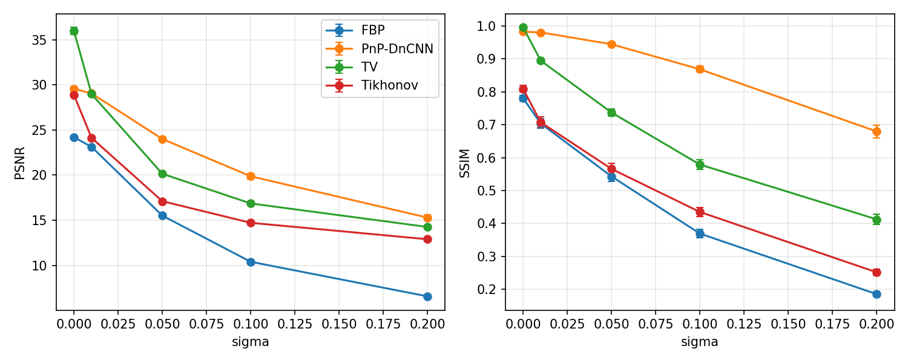
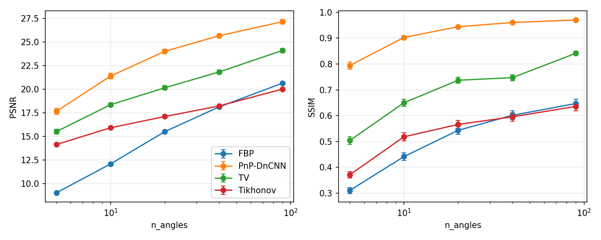
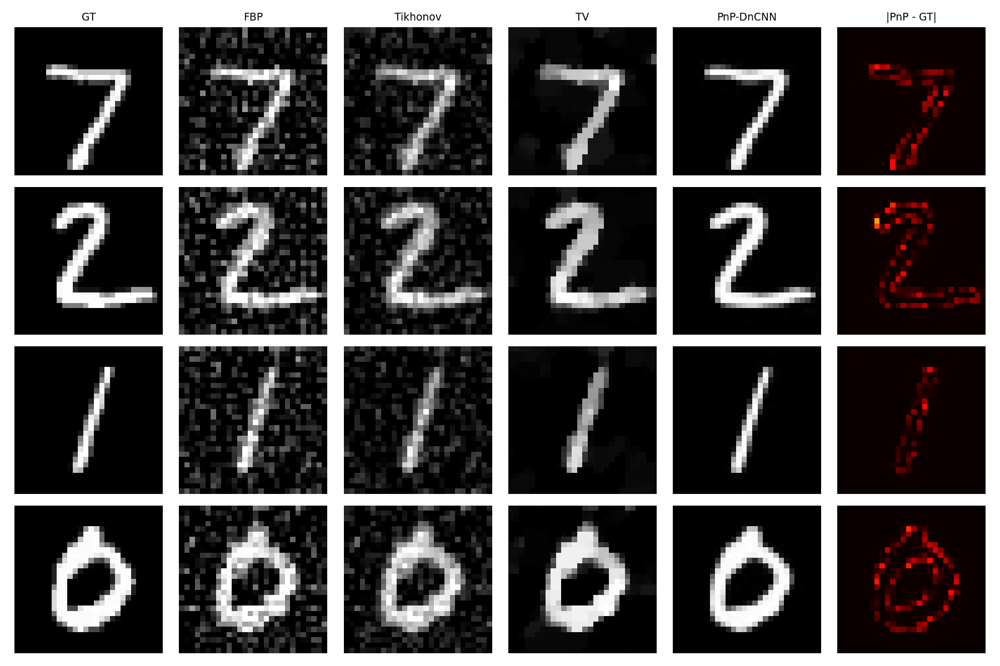
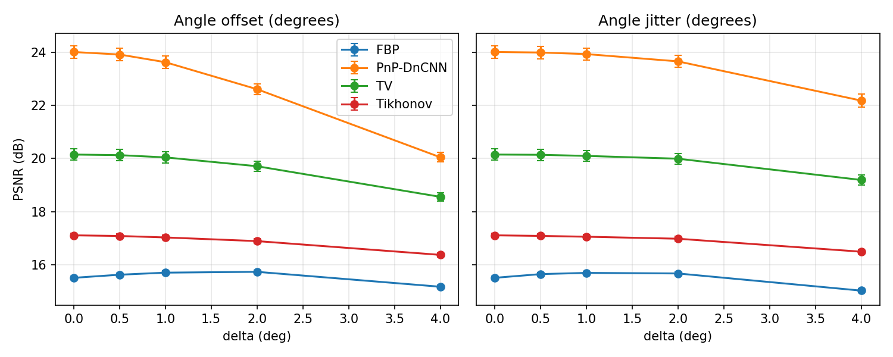
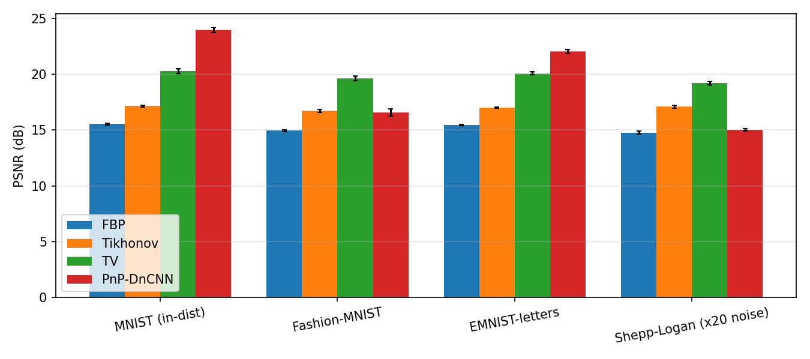

# Learned Regularization for Robust Image Reconstruction:

This report documents every experiment of the project in three stages, with
tables, statistical tests and limitations. The short version, headline table
and repository map are in [README.md](README.md); the technical paper is in
`paper/Learned_Regularization.pdf`.

**Three questions guided the work.**

1. Does the learned prior keep its advantage over TV when the image distribution changes?
2. Can we find cases where the method creates convincing but incorrect structures?
3. Do the conclusions hold over a range of noise levels and reconstruction conditions?

## How this report is organised

| Part | Sections | Data and setting | Experiments |
|---|---|---|---|
| I. Stage 1 | 1-11 | 28x28 MNIST-derived images, dense operator, Gaussian noise | E1-E10 |
| II. Stage 2 | 12-16 | same images, matrix-free operator, Poisson dose model | E11-E13 |
| III. Stage 3 | 17-26 | real LoDoPaB-CT slices (362x362), patient-disjoint split | E15-E19 |
| IV. Synthesis | 27-28 | all stages | - |

**Conventions.** PSNR is in dB. Stages 1-2 report mean and 95% CI over test
images with paired Wilcoxon tests; Stage 3 reports paired differences over
patients with a 95% percentile bootstrap, `*` marking an interval that excludes 0.
Finding numbers (Finding 1-4) are labels carried from the first version of this
report and are not in section order. Stage 3 results do not replace Stage 1-2
results: they answer the same questions on different data.

---

# Part I. Stage 1: 28x28 images, dense operator, Gaussian noise

## 1. Problem and methods

We study sparse-view computed tomography as a linear inverse problem
y = A x + n, where A is a sparse-angle Radon transform (few projection
angles), x is a 28x28 image, and n is additive Gaussian noise. A is
formed explicitly as a dense matrix, giving an exact adjoint A^T, which
is used both for the classical solvers below and for the learned
proximal-gradient scheme.

**Baselines (classical regularization):**
- Filtered back-projection (FBP)
- Tikhonov / L2 regularization (closed form)
- Total variation (TV), solved with ADMM

**Learned prior:** a noise-level-conditioned DnCNN denoiser D_sigma,
trained once on clean MNIST digits with Gaussian noise sigma in
[0, 0.3], used as an implicit prior inside a Plug-and-Play
proximal-gradient (PnP-PGD) iteration:

    x_{k+1} = D_{sigma_d}( x_k - eta * A^T(A x_k - y) ),   eta = 1 / L(A^T A)

All hyperparameters (Tikhonov lambda, TV lambda, PnP sigma_d and number
of iterations) are tuned by grid search on a held-out validation split,
separately for each experimental condition unless stated otherwise, and
then evaluated on a disjoint test split. Metrics are PSNR and SSIM,
reported as mean and 95% CI over test images, plus a paired Wilcoxon
signed-rank test between PnP and TV on matched images and noise
realizations.

## 2. In-distribution accuracy (E1: noise, E2: angles)

TV is a strong baseline on MNIST because digits are close to piecewise
constant. PnP overtakes it as soon as the problem is genuinely
ill-posed:

| Condition | FBP | Tikhonov | TV | PnP-DnCNN | PnP - TV |
|---|---|---|---|---|---|
| sigma=0, 20 angles | 24.2 | 28.9 | **36.0** | 29.6 | -6.4 dB |
| sigma=0.01, 20 angles | 23.1 | 24.1 | 29.0 | 29.1 | +0.07 dB (n.s., p=0.27) |
| sigma=0.05, 20 angles | 15.5 | 17.1 | 20.2 | **24.0** | +3.85 dB (p<1e-30) |
| sigma=0.1, 20 angles | 10.4 | 14.7 | 16.9 | **19.9** | +3.0 dB (p<1e-30) |
| sigma=0.2, 20 angles | 6.6 | 12.9 | 14.3 | **15.3** | +1.0 dB (p<1e-10) |
| 5 angles, sigma=0.05 | 9.1 | 14.2 | 15.5 | **17.7** | +2.15 dB (p<1e-25) |
| 90 angles, sigma=0.05 | 20.6 | 20.0 | 24.1 | **27.1** | +3.04 dB (p<1e-30) |

(PSNR in dB, test set, best hyperparameters per method and condition.
Full grid in `results/summary_table.md`; all values reproducible via
`run_baselines.py`, `run_pnp.py`, `make_plots.py`.)

**Finding 1.** The learned prior gives a large, statistically
significant improvement over TV whenever the problem is genuinely
under-determined or noisy (few angles, or sigma >= 0.05): up to +4 dB
PSNR and a jump in SSIM from ~0.74 to ~0.94 at sigma=0.05. In the
near-noiseless, well-posed regime TV wins clearly (-6.4 dB), because
its assumption (piecewise-constant images) is closer to exact for
MNIST digits than the CNN prior's implicit assumption.

**Figure: PSNR and SSIM vs. measurement noise (20 angles).** TV leads
at low noise (sigma <= 0.01); PnP-DnCNN overtakes all classical
baselines from sigma = 0.05 upward. Error bars: 95% CI over 200 test
images.

**Figure: PSNR and SSIM vs. number of projection angles (sigma=0.05).**
PnP-DnCNN leads across the entire range tested, with the largest
relative advantage under the most severe angular undersampling (5
angles). Error bars: 95% CI over 200 test images.

**Figure: Qualitative reconstructions (sigma=0.05, 20 angles).** Rows
are individual test digits; columns show ground truth, the three
classical baselines, PnP-DnCNN, and the absolute error map for
PnP-DnCNN. FBP and Tikhonov retain visible noise; TV looks blocky;
PnP-DnCNN is visually closest to the ground truth. Error is
concentrated on stroke edges, not flat regions.

## 3. Forward-model mismatch (E3)

Data are generated with the true 20-angle operator; reconstruction
uses a wrong operator with either a constant angle offset (rigid
mis-registration) or per-angle random jitter, up to 4 degrees.
Hyperparameters are frozen at their nominal (sigma=0.05, 20-angle)
values, not re-tuned per mismatch level.

- Under a 4-degree constant offset, PnP loses 4.0 dB (24.0 -> 20.0)
  while TV loses only 1.6 dB (20.2 -> 18.6). PnP's advantage over TV
  shrinks from +3.85 dB to +1.48 dB, but never disappears in this range.
- Under random per-angle jitter of the same magnitude, both methods
  degrade less (PnP: 24.0 -> 22.2; TV: 20.2 -> 19.2), and PnP remains
  clearly ahead.

**Figure: PSNR vs. angular error under forward-model mismatch**
(left: constant offset; right: per-angle jitter). Hyperparameters are
frozen at their delta=0 values. PnP-DnCNN stays ahead of all classical
baselines throughout, but loses ground faster than TV as the offset
grows, with its margin over TV shrinking from +3.85 dB at delta=0 to
+1.48 dB at delta=4 degrees. Error bars: 95% CI over 200 test images.

**Finding 3.** The learned prior is more sensitive to systematic
(rigid) forward-model error than TV is, even though it remains more
accurate in absolute terms over the tested range. A plausible
explanation is that PnP produces sharper, more confidently-placed
edges, which are penalized more by geometric misregistration than a
smoother TV reconstruction; this is a hypothesis, not something
independently verified here.

## 4. Distribution shift (E4)

The denoiser is trained only on MNIST digits. At test time the same
frozen pipeline (sigma=0.05, 20 angles) is applied to Fashion-MNIST,
EMNIST letters, and the Shepp-Logan phantom (single image, 20 noise
draws).

| Test set | TV | PnP-DnCNN | PnP - TV |
|---|---|---|---|
| MNIST (in-distribution) | 20.3 | **24.0** | +3.7 dB |
| EMNIST letters (near-shift) | 20.1 | **22.0** | +1.9 dB |
| Fashion-MNIST (far-shift) | **19.6** | 16.5 | -3.1 dB |
| Shepp-Logan phantom (far-shift) | **19.2** | 15.0 | -4.2 dB |

**Figure: PSNR under train-test distribution shift**, frozen pipeline
(sigma=0.05, 20 angles). PnP-DnCNN leads on MNIST (in-distribution)
and EMNIST (near-shift), but drops below TV and Tikhonov on Fashion-MNIST and the Shepp-Logan phantom (far-shift); it stays above FBP on Fashion-MNIST (16.5 vs 14.9 dB) and only marginally on the phantom (15.0 vs 14.8 dB). TV is the most
consistent method across all four sets. Note: the Shepp-Logan error
bar reflects noise-draw variation on a single image, not image-to-image
variation like the other three bars.

Note: TV on MNIST reads 20.3 dB here and 20.2 dB in the table of section 2 (a 0.1 dB difference between the two tables).

**Finding 4.** The prior generalizes to EMNIST letters, which share
digits' stroke-like statistics, but fails on Fashion-MNIST and the
Shepp-Logan phantom, both structurally unlike digits. `fig_shift_grid.png`
shows *how* it fails: not as generic blur, but as hallucinated
digit/stroke-like structure imposed on shoe textures and on the
phantom's interior, which is a more concerning failure mode than
graceful degradation, since the output can look confidently
structured while being wrong. This is the central limitation of the
project and the main argument for out-of-distribution testing of any
learned prior before deployment.

## 5. Why so few PnP iterations? (E5 ablation)

Validation tuning consistently selects very few PnP iterations
(5-25 for >= 10 angles and sigma <= 0.2; 100-400 for the 5-angle condition).
The convergence study (`fig_convergence.png`, 50 test images, sigma_d in {0.02, 0.05, 0.1, 0.2},
400 iterations) shows why: PSNR rises quickly, **peaks around iteration
5-15, and then decays to a lower plateau** (e.g. sigma_d=0.1: peak
~24.0 dB near iteration ~10, plateau ~22.0 dB by iteration 400).
Simultaneously the data-fidelity residual ||A x_k - y|| does *not*
decrease with iteration; it rises and plateaus, more so for larger
sigma_d.

**Finding 2.** This PnP-PGD scheme does not converge to a fixed point
that is both data-consistent and maximally accurate. The CNN denoiser
has no non-expansiveness guarantee, so continued iteration trades data
fidelity for an increasingly strong (and increasingly biased) prior
pull. Early stopping is therefore not a tuning artifact but a
necessary, active part of the regularization; this is consistent with
known limitations of PnP methods using unconstrained deep denoisers
(Ryu et al. 2019 and related PnP-convergence literature discuss this
trade-off explicitly).

## 6. Inverse crime (E6)

Measurements are also simulated on a 5x finer grid (nearest / bicubic / bilinear object). For sigma >= 0.05 the
PnP-TV gaps change by <= 0.3 dB (bicubic) so E1-E2 are unaffected. At sigma <= 0.01 the gap depends on the model
mismatch: sigma=0: -6.43 (crime), -5.86 (nearest), -3.29 (bicubic), -0.97 dB (bilinear); sigma=0.01: +0.07, +0.16,
+1.02, +1.76 dB. TV stays ahead at sigma=0 in every variant. The out-of-distribution deficits persist (Fashion
-2.8 to -3.9 dB, Shepp-Logan -4.2 to -5.4 dB).

## 7. Error decomposition (E7)

Subspace W of right singular vectors with s < 0.05 s_max (319 of 784 dims at 20 angles). In distribution PnP/TV error
ratio is 0.48 in W and 0.40 outside W (alignment 0.76 vs 0.45). On Shepp-Logan PnP places 3.3x the true energy in W
(TV 0.44) with alignment 0.23; on Fashion-MNIST the ratios are 1.27 (W) and 2.32 (outside W).

## 8. Seeds and matched prior (E8)

Seed-to-seed s.d. <= 0.3 dB. MNIST prior vs TV: MNIST +3.84 +/- 0.03, EMNIST +1.79 +/- 0.09, Fashion -3.10 +/- 0.30,
Shepp-Logan -4.33 +/- 0.12 dB. Fashion-trained prior: Fashion +2.21 +/- 0.01, MNIST +1.38, EMNIST +0.44, Shepp-Logan
-0.18 dB. The reversal is a prior-mismatch effect, not a PnP failure. sigma_max 0.5 does not change the shift results;
at sigma=0.2 the tuned sigma_d is 0.3 for all six MNIST denoisers (not a grid-edge artefact).

## 9. Lesion insertion (E9)

Paired AUC of PnP is below TV's in every condition except for the largest high-contrast lesion (e.g. 0.69 vs 0.91 for a
0.75 px, contrast 0.5 lesion, MNIST prior on MNIST). In distribution PnP attenuates lesions (retention 0.12-0.78 vs
0.29-0.88 for TV) and produces <= 0.01 false lesions/image; under prior mismatch (MNIST prior on Fashion) lesions survive
(retention 0.78-1.04) but 0.20-0.66 false lesions/image appear (TV <= 0.20; matched prior <= 0.01).

## 10. Operating points (E10)

Re-tuning PnP towards lesion fidelity recovers TV-level detection only by giving up its PSNR advantage or by
raising false lesions: MNIST prior in distribution, constrained point +0.7 dB over TV with paired AUC -0.06 and 12x TV's
false-lesion rate; lesion-tuned point 0.5 dB below TV with 60x its false-lesion rate. With a matched Fashion prior the
constrained point keeps +1.0 dB over TV with AUC within 0.02-0.03 of TV's. Under shift, operating points chosen in
distribution do not protect (2.1-2.8 dB below TV, 0.40-0.51 false lesions/image).

## 11. Stage 1 limitations

- Small scale: 28x28 MNIST-derived images; trends may not transfer directly to natural-image or clinical CT resolution and geometry (Stage 3 addresses this for one clinical dataset).
- Same forward operator used to generate and reconstruct data ("inverse crime") in E1-E5; E3 partially addresses this via mismatch. E6-E10 use bicubic finer-grid data and section 6 gives the sensitivity band. E3 and E5 were not repeated on finer-grid data.
- Three denoisers per configuration in E8-E10 (crude s.d.); one in E1-E5. Shepp-Logan is a single image.
- Lesion study: bright additive Gaussian blobs, location-known observer, modelling-choice false-lesion threshold; the operating-point study uses one denoiser per prior and two lesion types.
- Only two training distributions were compared; the asymmetric transfer is a hypothesis.
- Mismatch levels tested (angle error up to 4 degrees) are moderate; larger or structurally different mismatches were not tested.

---

# Part II. Stage 2: matrix-free operator and Poisson noise

## 12. Stage 2 methods: matrix-free operator and Poisson model

- `MatrixFreeRadon` never forms A: embed the 28x28 image in a 40x40 canvas, rotate by each angle (bilinear, about the pixel used by skimage), sum along detector rows. The adjoint is the exact transpose, obtained by autograd. Tikhonov and TV use conjugate gradients; subspaces use a randomized SVD (forward and adjoint products only).
- Poisson model: counts N ~ Poisson(I0 exp(-mu * A x)), data = -log(max(N,1)/I0)/mu, mu = 2. Data are generated on the finer grid (bicubic, factor 5). I0 = 1000, 300, 100, 30, 10 gives an effective sinogram noise std of 0.018, 0.032, 0.056, 0.106, 0.198. Hyperparameters are tuned per dose on 100 held-out validation images and frozen for all test sets.

## 13. Equivalence with the dense pipeline (200 images, GPU) (E11)

| Method | rel. difference | PSNR | time dense (s) | time matrix-free (s) |
|---|---|---|---|---|
| Tikhonov | 4.6e-6 | 16.36 | 0.08 | 0.26 |
| TV-ADMM | 9.7e-6 | 19.01 | 0.16 | 7.50 |
| PnP (k=25) | 2.8e-4 | 23.10 | 0.76 | 0.94 |

Forward difference 2.9e-7; peak GPU memory 184 MB. The randomized SVD finds the same 465-dimensional strong subspace as the dense SVD. At 28x28 the dense operator is faster; the matrix-free one is needed for larger images.

## 14. Poisson dose sweep, PnP - TV (dB, mean +/- s.e. of the paired difference, 200 images) (E12)

| I0 (photons/ray) | 1000 | 300 | 100 | 30 | 10 |
|---|---|---|---|---|---|
| effective sigma | 0.018 | 0.032 | 0.056 | 0.106 | 0.198 |
| MNIST | +2.87 +/- 0.07 | +3.68 +/- 0.08 | +3.65 +/- 0.08 | +2.39 +/- 0.12 | +0.82 +/- 0.12 |
| EMNIST | +1.40 +/- 0.09 | +1.59 +/- 0.08 | +1.82 +/- 0.08 | +0.77 +/- 0.11 | +0.62 +/- 0.10 |
| Fashion-MNIST | -2.45 +/- 0.13 | -3.05 +/- 0.16 | -2.74 +/- 0.16 | -3.01 +/- 0.14 | -1.98 +/- 0.13 |
| Shepp-Logan (1 image) | -4.41 | -6.05 | -5.05 | -5.49 | -4.75 |

Same ranking and the same reversal under shift as with Gaussian noise (Stage 1: MNIST +3.84, EMNIST +1.79, Fashion -3.10, Shepp -4.33 dB at sigma = 0.05). The Poisson-weighted PnP variant was 0.14-0.59 dB below the unweighted one in 13 of 15 non-phantom cells (and above it in two cells where the tuned parameters differed): no consistent benefit.

## 15. Lesion insertion under Poisson noise (3 denoisers per prior, 200 images per set) (E13)

- Erasure persists: PnP paired AUC is below TV in all four prior/test-set combinations at both doses (-0.01 to -0.28 at I0 = 100). MNIST prior on MNIST, sigma_l = 0.75, c = 0.5: paired AUC 0.89 (TV) vs 0.60 (PnP), retention 0.60 vs 0.29 at I0 = 100 (Stage 1: 0.91 vs 0.69; 0.59 vs 0.28), while PnP is 3.7 dB better in PSNR.
- Invention under mismatch persists: MNIST prior on Fashion-MNIST gives more false lesions than TV for lesions with sigma_l >= 0.75 in 11 of 12 dose/type cells (factor 1.7-5.5; 0.25-0.70 vs 0.06-0.28 per image at I0 = 100). Matched priors stay at <= 0.09 false lesions per image.
- New at I0 = 30: the MNIST prior on MNIST makes 0.058-0.073 false lesions per image for the four types with 0.75 <= sigma_l <= 1.25 (TV 0.000-0.035); at I0 = 100 it makes at most 0.01.
- TV has noise blobs of its own on the smallest low-contrast lesion at I0 = 100 (0.63 false lesions per image vs 0.01 for PnP).
- Uncertainty: error bars show only the 3 denoiser seeds; TV is a single run; the sampling error of a paired AUC with ~170 lesions is about +/-0.03. The observability-tercile pattern (PnP AUC falls with observability on MNIST images only) is exploratory and not interpreted.

## 16. Stage 2 limitations

- One attenuation scale (mu = 2), one angle count; the dose sweep uses one MNIST-trained denoiser, so its shift results have no seed uncertainty; Shepp-Logan is one image and one noise draw per dose.
- The lesion study inherits the limitations of E9 (bright Gaussian blobs, location-known observer, threshold-defined false lesions).
- The matrix-free operator was validated only at 28x28; there the matrix-free TV-ADMM solver is about 47x slower than the dense one. Stage 3 does not use it: it uses a GPU Chambolle-Pock TV solver (about 8.6 s per slice per solve at 362x362, K=60).

---

# Part III. Stage 3: clinical-size data (LoDoPaB-CT)

## 17. Stage 3 data, geometry, dose model and simulator check

Question 1: does the learned prior keep its advantage over TV when the image distribution changes? Question 2: can we find cases where it creates convincing but incorrect structures? Question 3: do the conclusions hold over noise levels and reconstruction conditions?

**Data.** 362x362 slices (mu/mu_max in [0,1]), 1000-angle parallel-beam observations. Official split: 35,820 training slices / 632 patients, 3,522 validation / 60, 3,553 test / 60; the patient ids are disjoint (checked). Denoiser training: 8,960 training slices. Tuning: 20 validation slices (20 patients). Evaluation: 40 test slices, one per patient, the same 40 everywhere; the patient is the unit of analysis.
**Geometry.** Matrix-free parallel-beam operator; conventions fixed by comparing projections of the ground truth with the supplied observations over 16 variants (selected: relative residual 0.038, correlation 0.9979; best alternative 0.166; fitted pixel size 1.0044 x nominal). K = 30, 60, 120 evenly spaced angles of 1000.
**Dose.** y = -ln(N/N0)/mu_max, N ~ Poisson(N0 exp(-mu_max A x)), N0 = 4096, mu_max = 81.35858 /m, zero counts -> 0.1. Check: recovered counts are integers in 100% of bins for N0 = 4096 (9.7-10.4% for perturbed mu_max; chance 10%); dispersion index 1.06 / 1.25 / 1.81 for expected counts in [20,200) / [200,1000) / [1000,5000) (includes model error). Doses f = 1, 0.25, 0.1 of 4096 photons: exact binomial thinning of the real counts (tuning); crime-free simulation (bicubic x2, 724x724 fine grid, bin-pair averaging, Poisson) for evaluation.
**Simulator check (TV PSNR, real vs simulated, first 8 test slices; dB).**

| K / dose | 30/1 | 30/0.25 | 30/0.1 | 60/1 | 60/0.25 | 60/0.1 | 120/1 | 120/0.25 | 120/0.1 |
|---|---|---|---|---|---|---|---|---|---|
| real | 29.34 | 27.95 | 26.57 | 30.15 | 28.40 | 26.73 | 30.61 | 28.54 | 27.89 |
| simulated | 29.41 | 27.90 | 26.52 | 30.27 | 28.45 | 26.72 | 30.76 | 28.55 | 27.85 |

At K=60 with all 40 slices: TV 31.91 vs 32.04 (dose 1) and 29.82 vs 29.83 (dose 0.25); FBP-Hann 30.65 vs 30.59 and 28.73 vs 28.66.

## 18. Stage 3 methods, tuning and analysis history

FBP-Hann (cut-off tuned); TV (Chambolle-Pock, isotropic, box [0,1], 150 iterations from FBP-Hann); TV-long (300 iterations, own weight; control for PnP's extra iterations); PnP-const (x <- D(x - eta A^T(Ax - y)), eta = 1/L, start FBP-Hann, (sigma_d, k) tuned); PnP-TVinit (start from the TV solution). D: noise-conditioned DnCNN (8 layers, 64 channels), 15,000 steps, batch 16, 128x128 crops, sigma ~ U(0, 0.1); validation PSNR 33.98 -> 41.98, 26.02 -> 38.45, 20.00 -> 35.53 dB at sigma = 0.02, 0.05, 0.1.
Every method and condition is tuned on the 20 validation slices (real observations, thinned and subsampled) by mean PSNR (peak 1, clipped to [0,1]); grids extend automatically (up to twice) when the optimum is on an edge.

| K | dose | Hann | TV lambda | PnP-const (sigma_d, k) | PnP-TVinit (sigma_d, k) |
|---|---|---|---|---|---|
| 30 | 1 | 0.2 | 0.003 | (0.02, 12) | (0.02, 4) |
| 30 | 0.25 | 0.16 | 0.01 | (0.05, 8) | (0.08, 4) |
| 30 | 0.1 | 0.12 | 0.03 | (0.08, 12) | (0.05, 8) |
| 60 | 1 | 0.3 | 0.003 | (0.02, 8) | (0.02, 2) |
| 60 | 0.25 | 0.2 | 0.01 | (0.08, 4) | (0.02, 8) |
| 60 | 0.1 | 0.12 | 0.03 | (0.05, 12) | (0.02, 12) |
| 120 | 1 | 0.4 | 0.003 | (0.05, 2) | (0.0039, 8) (edge) |
| 120 | 0.25 | 0.2 | 0.01 | (0.02, 12) | (0.0062, 8) |
| 120 | 0.1 | 0.16 | 0.01 | (0.05, 8) | (0.128, 1) (edge) |

TV-long used the same weight as TV in every condition. Two optima remain on a grid boundary (PnP-TVinit: sigma_d at the lower end at K=120/dose 1, i.e. almost no denoising; k = 1 at K=120/dose 0.1): in these cells it is essentially TV plus a few data-consistency steps.

**Lesion observer.** Additive Gaussian blobs, sigma_l = 2 and 4 px (1.4 and 2.9 mm at 0.72 mm/px), contrast 0.06 on the mu/mu_max scale (K=60 steps also 0.03). With water ~ 0.25 (an assumption) this is roughly 240 HU (0.03: 120 HU): small and noisy, but not clinically low-contrast. Four lesions per slice at least 44 px apart, inside the body eroded by 22 px (CT) or the central square (phantoms); lesion-free and lesion-present images reconstructed from independent noise. Statistic: location-known zero-sum local contrast (disc radius ceil(1.5 sigma_l) minus a 3-px annulus); score: paired AUC pooled over valid lesions (inserted response >= half nominal). False blob: local maximum (5x5) of the response map of a lesion-free reconstruction with response >= m x nominal (m = 0.5, 0.75, 1, 1.5) and no truth response above half of 0.5 x nominal within 2 px. No reader study: "convincing" means lesion-like response at the kernel scale.
**Statistics.** Paired differences on the same patients and simulated data, 95% percentile bootstrap over patients (2,000 resamples in the K=60 lesion experiments, 5,000 elsewhere), same resamples for both methods; lesion types pooled with equal weight. No multiplicity correction: read sign counts across conditions, not single intervals (25 of 80 and 35 of 80 per-type intervals excluded 0 against about 4 expected by chance). One noise realisation per condition (AUC cell precision about +/-0.05).

**Analysis history (read before the numbers).** (i) A first K=60 comparison (6 validation slices, Hann cut-off 0.2) had PnP 0.85 and 0.33 dB below TV (dose 1, 0.25). With 20 slices (cut-off 0.3 at dose 1) PnP-const rose by 1.06 dB (30.68 -> 31.74) and 0.32 dB (29.40 -> 29.72), TV by 0.38 and 0.09 dB, and the gap became -0.17 and -0.10 dB. The first gap was an artefact of the starting image and the small tuning set and is not used. (ii) The lesion experiments were first tuned on 10 slices with narrow grids and repeated on 20 slices with extended grids and a separately tuned TV-long: at dose 1 the parameters of FBP, TV, TV-long and PnP-const did not change (PnP-TVinit PSNR changed by 0.07 dB), no pooled verdict changed; at dose 0.25 one of 20 pooled verdicts changed (PnP-TVinit - TV-long AUC, significant -> not significant). (iii) Paired statistics, the threshold sweep and the false-blob definition were added after seeing the first lesion results; the dose x angle grid and the shift extension to K = 30, 120 were run afterwards. Nothing was pre-specified.

## 19. E15: PnP variants vs TV at K=60 (real slices, 40 patients)

| Method | dose 1: PSNR | SSIM | - TV | dose 0.25: PSNR | SSIM | - TV |
|---|---|---|---|---|---|---|
| FBP-Hann | 30.65 | 0.738 | -1.27* | 28.73 | 0.699 | -1.09* |
| TV | 31.91 | 0.786 | - | 29.82 | 0.750 | - |
| PnP-const [d8] | 31.74 | 0.773 | -0.17* [-0.21, -0.13] | 29.72 | 0.734 | -0.10* [-0.18, -0.03] |
| PnP-TVinit [d8] | 31.94 | 0.784 | +0.03 [-0.00, +0.06] | 30.03 | 0.753 | +0.21* [+0.17, +0.25] |
| PnP-anneal [d8] | 31.26 | 0.769 | -0.65* [-0.77, -0.52] | 29.94 | 0.750 | +0.12* [+0.05, +0.18] |
| TV+denoise [d8] | 31.91 | 0.785 | +0.00 [-0.02, +0.03] | 29.77 | 0.747 | -0.05 [-0.10, +0.01] |
| PnP-const [d17] | 31.61 | 0.777 | -0.30* [-0.35, -0.26] | 29.57 | 0.737 | -0.25* [-0.31, -0.19] |
| PnP-TVinit [d17] | 31.89 | 0.785 | -0.02 [-0.06, +0.03] | 29.97 | 0.755 | +0.15* [+0.12, +0.18] |
| PnP-anneal [d17] | 31.20 | 0.772 | -0.71* [-0.85, -0.58] | 29.87 | 0.753 | +0.05 [-0.01, +0.12] |
| TV+denoise [d17] | 31.90 | 0.786 | -0.02 [-0.05, +0.02] | 29.84 | 0.752 | +0.02* [+0.00, +0.04] |

(PSNR dB; paired difference to TV, mean and 95% interval over patients; * excludes 0; d8 / d17: 8- and 17-layer denoiser.) A deeper denoiser does not help; the best variant (TV start + a few PnP steps) gains at most 0.21 dB over TV. On clinical-size slices the learned prior is competitive with TV in PSNR, not about +4 dB better as on 28x28 digits.

## 20. E16: accuracy over the dose x angle grid (lesion-free arm, 40 patients)

Observations in this experiment are simulated (crime-free simulator, section 17), unlike the real thinned sinograms of E15; this is why TV at K=60/dose 1 reads 31.91 in E15 and 32.04 here.

Mean PSNR (dB), best per condition in bold; columns K / dose:

| Method | 30/1 | 30/0.25 | 30/0.1 | 60/1 | 60/0.25 | 60/0.1 | 120/1 | 120/0.25 | 120/0.1 |
|---|---|---|---|---|---|---|---|---|---|
| FBP-Hann | 29.02 | 27.72 | 26.63 | 30.59 | 28.66 | 27.11 | 31.70 | 29.18 | 27.94 |
| TV | 30.98 | 29.15 | 27.69 | 32.04 | 29.83 | 27.93 | 32.64 | 30.07 | 29.13 |
| TV-long | **31.31** | 29.21 | 27.72 | **32.12** | 29.88 | 27.98 | 32.50 | 30.11 | 29.21 |
| PnP-const | 30.38 | 29.05 | 27.86 | 31.85 | 29.68 | 28.31 | 32.64 | 30.23 | 28.86 |
| PnP-TVinit | 31.15 | **29.22** | **27.96** | 32.09 | **30.04** | **28.47** | **32.92** | **30.46** | **29.26** |

Mean SSIM:

| Method | 30/1 | 30/0.25 | 30/0.1 | 60/1 | 60/0.25 | 60/0.1 | 120/1 | 120/0.25 | 120/0.1 |
|---|---|---|---|---|---|---|---|---|---|
| FBP-Hann | 0.692 | 0.666 | 0.655 | 0.738 | 0.699 | 0.680 | 0.763 | 0.725 | 0.693 |
| TV | 0.765 | 0.733 | 0.710 | 0.788 | 0.750 | 0.717 | 0.799 | 0.756 | 0.741 |
| TV-long | **0.773** | **0.737** | 0.713 | **0.790** | 0.753 | 0.720 | 0.797 | 0.758 | **0.745** |
| PnP-const | 0.745 | 0.726 | 0.707 | 0.775 | 0.733 | 0.721 | 0.793 | 0.749 | 0.731 |
| PnP-TVinit | 0.767 | 0.730 | **0.721** | 0.786 | **0.753** | **0.731** | **0.805** | **0.761** | 0.740 |

Paired differences (mean [95% interval]; * excludes 0):

| K | dose | PSNR: PnP-const - TV-long | SSIM: PnP-const - TV-long | PSNR: PnP-TVinit - TV-long | PSNR: PnP-const - FBP-Hann |
|---|---|---|---|---|---|
| 30 | 1 | -0.93* [-1.09, -0.75] | -0.027* [-0.035, -0.021] | -0.15* [-0.24, -0.06] | +1.36* [+1.15, +1.58] |
| 30 | 0.25 | -0.15 [-0.36, +0.08] | -0.011* [-0.019, -0.002] | +0.01 [-0.19, +0.24] | +1.33* [+1.06, +1.62] |
| 30 | 0.1 | +0.13* [+0.03, +0.23] | -0.006 [-0.014, +0.001] | +0.24* [+0.19, +0.29] | +1.22* [+0.98, +1.48] |
| 60 | 1 | -0.28* [-0.33, -0.22] | -0.015* [-0.019, -0.011] | -0.03* [-0.06, -0.00] | +1.25* [+0.97, +1.56] |
| 60 | 0.25 | -0.20* [-0.28, -0.13] | -0.020* [-0.027, -0.012] | +0.16* [+0.11, +0.21] | +1.02* [+0.65, +1.41] |
| 60 | 0.1 | +0.33* [+0.23, +0.43] | +0.001 [-0.003, +0.005] | +0.49* [+0.37, +0.62] | +1.20* [+1.04, +1.37] |
| 120 | 1 | +0.14* [+0.05, +0.24] | -0.004* [-0.007, -0.001] | +0.41* [+0.32, +0.50] | +0.95* [+0.54, +1.39] |
| 120 | 0.25 | +0.13 [-0.02, +0.27] | -0.009* [-0.013, -0.006] | +0.35* [+0.25, +0.45] | +1.05* [+0.89, +1.22] |
| 120 | 0.1 | -0.34* [-0.47, -0.22] | -0.013* [-0.020, -0.007] | +0.06 [-0.07, +0.19] | +0.92* [+0.73, +1.13] |

- PnP-const and TV-long beat FBP-Hann in PSNR (by 0.93-1.36 dB and 0.81-2.28 dB) and SSIM in all nine conditions.
- PnP-const is not better than TV-long on average: PSNR difference -0.93 to +0.33 dB; significantly positive in 3 conditions (K=30 and 60 at dose 0.1; K=120 at dose 1), significantly negative in 4 (K=30 and 60 at dose 1; K=60 at dose 0.25; K=120 at dose 0.1), not significant in 2. SSIM is lower in 8 of 9 (significantly in 7), higher in 1 (+0.001, ns). The sign does not follow dose or angle count monotonically.
- PnP-TVinit has the highest mean PSNR in 7 of 9 conditions, by at most 0.49 dB over TV-long (significantly higher in 5, lower in 2: K=30/dose 1, -0.15 dB; K=60/dose 1, -0.03 dB). Two of its cells are not denoiser effects (section 18).
- TV-long is slightly worse than TV at K=120/dose 1 (32.50 vs 32.64 dB): the early-stopped TV is itself a tuned object and the weight grid (factor 3) is coarse.

## 21. E17: lesion detection

Paired AUC differences (sigma_l = 2 and 4 pooled, contrast 0.06, 40 patients; mean [95% interval]; * excludes 0):

| K | dose | PnP-const - TV-long | PnP-const - TV | PnP-const - FBP-Hann | TV-long - FBP-Hann | PnP-TVinit - TV-long |
|---|---|---|---|---|---|---|
| 30 | 1 | +0.044 [-0.009, +0.097] | +0.006 [-0.050, +0.059] | -0.075* [-0.116, -0.037] | -0.119* [-0.169, -0.072] | +0.066* [+0.019, +0.113] |
| 30 | 0.25 | +0.034 [-0.025, +0.094] | +0.078* [+0.013, +0.144] | -0.006 [-0.056, +0.041] | -0.041 [-0.103, +0.025] | +0.069* [+0.006, +0.131] |
| 30 | 0.1 | +0.091* [+0.019, +0.162] | +0.137* [+0.059, +0.216] | +0.031 [-0.028, +0.091] | -0.059 [-0.141, +0.019] | +0.053 [-0.022, +0.128] |
| 60 | 1 | +0.050 [-0.006, +0.103] | +0.000 [-0.050, +0.050] | -0.037 [-0.091, +0.012] | -0.087* [-0.144, -0.031] | +0.069* [+0.031, +0.109] |
| 60 | 0.25 | +0.100* [+0.050, +0.150] | +0.078* [+0.028, +0.131] | -0.009 [-0.059, +0.041] | -0.109* [-0.175, -0.047] | +0.084* [+0.031, +0.141] |
| 60 | 0.1 | +0.163* [+0.078, +0.247] | +0.144* [+0.072, +0.219] | -0.041 [-0.097, +0.009] | -0.203* [-0.291, -0.119] | +0.156* [+0.084, +0.231] |
| 120 | 1 | +0.109* [+0.066, +0.156] | +0.084* [+0.044, +0.125] | +0.003 [-0.031, +0.041] | -0.106* [-0.162, -0.053] | +0.091* [+0.050, +0.137] |
| 120 | 0.25 | +0.112* [+0.041, +0.184] | +0.081* [+0.006, +0.156] | -0.059* [-0.103, -0.013] | -0.172* [-0.247, -0.094] | +0.166* [+0.109, +0.222] |
| 120 | 0.1 | +0.084* [+0.025, +0.147] | +0.084* [+0.028, +0.147] | +0.013 [-0.047, +0.072] | -0.072* [-0.128, -0.016] | +0.022 [-0.041, +0.081] |

- PnP-const > TV-long in 9 of 9 conditions (+0.03 to +0.16), significant in 6 (all three K=120, K=60 at doses 0.25 and 0.1, K=30 at dose 0.1); not significant at dose 1 for K=30, 60.
- PnP-const is never significantly above FBP-Hann (3 positive, 6 negative differences) and significantly below it in 2 (K=30/dose 1: -0.075; K=120/dose 0.25: -0.059): the prior removes TV's detection deficit; it does not add to FBP's detectability.
- TV-long < FBP-Hann in 9 of 9 (significant in 7; down to -0.20 at K=60/dose 0.1) although +0.81 to +2.28 dB in PSNR: PSNR and detectability rank the methods in opposite order.
- PnP-TVinit > TV-long in 9 of 9 (+0.02 to +0.17), significant in 7.
- Retention (K=60, dose 1, four lesion types): TV and PnP keep 7-32% of the local-contrast difference, FBP-Hann 31-67%; the AUC of the regularised methods comes from noise suppression, not from contrast preservation.
- K=60 analysis with four lesion types (re-tuned, 160 lesions per type): PnP-const - TV-long = +0.023 [-0.013, +0.061] (dose 1) and +0.073 [+0.023, +0.128] (dose 0.25); PnP-const - FBP-Hann -0.008 and +0.016 (ns); TV - FBP-Hann -0.037 (ns) and -0.056 [-0.11, -0.00]. At sigma_l = 4, contrast 0.06 all methods reach AUC 0.95-0.96 at dose 1 (ceiling).

## 22. E18: false structures on real slices

Mean false blobs per lesion-free slice at 1x nominal strength (mean of sigma_l = 2, 4; the four conditions also used in the shift study):

| K / dose | FBP-Hann | TV | TV-long | PnP-const | PnP-TVinit | PnP-const - FBP-Hann |
|---|---|---|---|---|---|---|
| 30 / 0.25 | 9.78 | 5.56 | 6.06 | 0.75 | 0.64 | -9.03* [-13.21, -5.20] |
| 30 / 1 | 5.78 | 1.04 | 1.69 | 0.50 | 0.32 | -5.28* [-7.54, -3.29] |
| 120 / 0.25 | 5.79 | 0.02 | 0.02 | 1.38 | 0.39 | -4.41* [-7.34, -2.00] |
| 120 / 1 | 26.79 | 0.12 | 0.00 | 0.24 | 0.18 | -26.55* [-43.93, -12.63] |

Paired differences over all nine conditions (false blobs per slice; mean [95% interval]):

| K | dose | m=1: PnP-const - TV-long | m=1: PnP-const - TV | m=1.5: PnP-const - TV-long |
|---|---|---|---|---|
| 30 | 1 | -1.19 [-2.79, +0.05] | -0.54 [-1.57, +0.36] | -0.23 [-0.64, +0.11] |
| 30 | 0.25 | -5.31* [-9.15, -2.31] | -4.81* [-8.41, -2.00] | -2.42* [-4.56, -0.82] |
| 30 | 0.1 | +0.21 [-0.20, +0.64] | +0.31 [-0.12, +0.76] | +0.00 [-0.14, +0.14] |
| 60 | 1 | +0.46* [+0.12, +0.88] | +0.19* [+0.01, +0.40] | +0.12* [+0.03, +0.25] |
| 60 | 0.25 | -0.40* [-0.68, -0.17] | -0.60* [-1.11, -0.19] | -0.11* [-0.25, -0.01] |
| 60 | 0.1 | -0.07 [-0.25, +0.07] | -0.05 [-0.20, +0.09] | -0.01 [-0.06, +0.04] |
| 120 | 1 | +0.24* [+0.04, +0.51] | +0.11* [+0.01, +0.25] | +0.06 [+0.00, +0.15] |
| 120 | 0.25 | +1.35* [+0.53, +2.30] | +1.35* [+0.54, +2.29] | +0.45* [+0.16, +0.81] |
| 120 | 0.1 | -0.93* [-1.50, -0.45] | -0.88* [-1.48, -0.39] | -0.11* [-0.26, -0.01] |

- At m=1, PnP-const - TV-long is significantly positive in 3 conditions (K=60/dose 1: +0.46; K=120: +0.24, +1.35), significantly negative in 3 (K=30/0.25: -5.31; K=60/0.25: -0.40; K=120/0.1: -0.93), not significant in 3: no pattern in dose or K. At m=1.5 the excess over TV-long is at most 0.45 per slice.
- K=60 (four lesion types, threshold m=0.5): PnP-const has fewer false blobs than TV (-1.7 at dose 1, -6.6 at dose 0.25).
- Gallery (`step4b_gallery_*.png`): the largest false blobs also occur in FBP-Hann and TV, i.e. they come from the data (few views, noise, streaks); only a few look prior-specific (a crescent in one slice at dose 1; streaks in the PnP-TVinit image of one slice at dose 0.25).
- Conclusion: no evidence that the prior creates many lesion-like structures in distribution; rare ones cannot be excluded with 40 slices and one noise draw.

## 23. E19: distribution shift to non-anatomical phantoms

The CT-trained prior and all tuned parameters are applied without retuning to 20 piecewise-constant phantoms (ellipses, rectangles, stripe/checker block on a faint disc; same phantoms in every condition). K=60 was run first (four lesion types); K=30 and 120 followed (two lesion types), so the designs differ slightly.

Left: false blobs per phantom at 1x strength, PnP-const - TV, by lesion size. Right: PnP-const - TV-long on phantoms (pooled AUC, PSNR dB, SSIM). K=60 rows: AUC from four lesion types, PSNR as a difference of means (no interval), SSIM not computed.

| K | dose | false blobs, sigma_l=2 | false blobs, sigma_l=4 | AUC | PSNR | SSIM |
|---|---|---|---|---|---|---|
| 30 | 1 | -70.7* [-107.0, -38.7] | -31.8* [-48.7, -16.8] | -0.037 [-0.113, +0.037] | -0.11 [-0.37, +0.18] | -0.095* [-0.125, -0.063] |
| 30 | 0.25 | -21.1* [-34.3, -10.3] | -1.8 [-5.8, +1.8] | +0.056 [-0.031, +0.144] | -0.53* [-0.64, -0.40] | -0.190* [-0.204, -0.172] |
| 60 | 1 | -20.1* [-34.4, -7.6] | -6.5* [-12.6, -1.4] | -0.019 [-0.06, +0.02] | -0.30 (mean difference, no interval) | n/a |
| 60 | 0.25 | -7.5* [-12.9, -2.8] | +9.1* [+6.0, +12.8] | +0.050 [-0.01, +0.11] | -0.75 (mean difference, no interval) | n/a |
| 120 | 1 | +13.0* [+8.8, +17.5] | +9.2* [+5.4, +13.2] | +0.075* [+0.013, +0.137] | -0.51* [-0.56, -0.45] | -0.179* [-0.190, -0.168] |
| 120 | 0.25 | +10.4* [+5.9, +16.0] | +9.0* [+5.9, +12.3] | -0.062 [-0.162, +0.031] | -0.62* [-0.68, -0.57] | -0.155* [-0.162, -0.149] |

Mean false blobs per lesion-free image at 1x (mean of sigma_l = 2, 4):

| K / dose | FBP-Hann | TV | TV-long | PnP-const | PnP-TVinit | PnP-const - FBP-Hann |
|---|---|---|---|---|---|---|
| 30 / 0.25 | 15.48 | 27.95 | 30.20 | 16.50 | 11.65 | +1.03 [-0.68, +2.75] |
| 30 / 1 | 31.60 | 75.72 | 83.90 | 24.48 | 57.30 | -7.13* [-10.68, -4.02] |
| 120 / 0.25 | 8.72 | 3.08 | 3.18 | 12.75 | 11.48 | +4.03* [+2.35, +5.90] |
| 120 / 1 | 118.68 | 39.20 | 32.08 | 50.30 | 46.12 | -68.38* [-92.68, -45.23] |

- Accuracy: PnP-const is below TV-long in PSNR in all six conditions (-0.11 to -0.75 dB; significant in 3 of the 4 with an interval) and in SSIM in all four (-0.095 to -0.190, all significant; on CT -0.004 to -0.027). At dose 0.25 its SSIM is also below FBP-Hann's on the phantoms (-0.045 at K=30, -0.041 at K=120).
- Detection: advantage over TV-long significant in 1 of 6 shift conditions (K=120/dose 1: +0.075 [+0.013, +0.137]) vs 3 of the 6 corresponding CT conditions; shift effect significantly negative only at K=120/dose 0.25 (-0.175 [-0.297, -0.056]). With 20 phantoms (interval widths 0.12-0.19) we cannot say the advantage is lost, only that it is not reliably transferred.
- False blobs: the sign of PnP-const - TV follows K (negative or null at K=30, negative at K=60/dose 1, mixed at K=60/dose 0.25, positive at K=120: +9.0 to +13.0). It follows the baseline: TV-long's count varies 26-fold across the four conditions (3.2-83.9 per phantom), PnP-const's about 4-fold (12.8-50.3); at K=30 TV-long makes 2-3 times as many blobs as FBP-Hann, at K=120 a third or less.
- Relative to FBP-Hann: fewer false blobs at dose 1; at dose 0.25 more (+1.0 ns at K=30, +4.0* at K=120; at 1.5x: +2.2* and +2.7*), whereas on real slices it has significantly fewer in both dose-0.25 conditions (-9.0, -4.4). By lesion size at 1x: for sigma_l = 2, PnP-const has more false blobs than FBP-Hann in 3 of 4 conditions (+10.1, +9.7, +10.6); for sigma_l = 4 fewer in all four.
- At K=120/dose 1, PnP-TVinit with almost no denoising (sigma_d = 0.0039) also has 14.0 more false blobs than TV-long ([+7.4, +22.0]), so at least part of the K=120 excess is not due to the denoiser (cause not isolated).

## 24. Stage 3 answers to the three questions

**Q1 (advantage under distribution change).** The advantage that appears in most conditions on real slices is detection over TV-long (PSNR gains are small and mixed: PnP-const is significantly above TV-long in 3 of 9 conditions and below in 4). The detection advantage is kept in 1 of 6 shift conditions, significantly smaller than on CT in 1 (K=120/dose 0.25) and not significantly different from CT in the 3 other conditions where this was tested (K=60 not tested). The PSNR and SSIM deficit against TV grows under shift.
**Q2 (convincing but incorrect structures).** Yes at dose 0.25 on phantoms (a few false blobs per phantom more than FBP-Hann; in the K=120 conditions more than TV). Not on real slices: fewer than FBP-Hann in all four conditions examined and at most 1.4 per slice at lesion strength; where large false blobs occur they also occur in FBP and TV. "No evidence of many" is not "none": rare structures are not excluded, and no reader study was done.
**Q3 (robustness over conditions).** The sign of the detection advantage over TV-long holds in 9 of 9 conditions (significant in 6). The PSNR, SSIM and false-blob conclusions do not: their signs change with dose and angle count without a monotone trend.

## 25. Stage 3 limitations

- 40 test patients, one noise realisation per condition (AUC cell precision about +/-0.05); conditions share patients and are not independent; per-type rows are exploratory.
- No multiplicity correction; the analysis was developed in steps after seeing results (section 18); the shift extension was chosen after the K=60 results.
- One denoiser architecture and one training run, 8,960 of 35,820 training slices; the comparison does not separate the prior from this network. PSNR was the tuning criterion for every method, which favours accuracy over detectability.
- TV weight grid has steps of a factor 3; TV-long is sometimes worse than TV; two PnP-TVinit optima are on a grid boundary.
- Simulator checked against real data on 8 slices per condition (within 0.15 dB TV PSNR); real data may have more variance than the simulation at high counts.
- Lesions: additive Gaussian blobs, 120-240 HU under an assumed mu/mu_max-to-HU mapping, location-known observer, false blobs defined by statistic and threshold; clinically low-contrast lesions, other observers and search tasks are untested.
- Phantoms are piecewise constant (favour TV); one kind of shift; no change of geometry or dose model. K=60 shift: four lesion types vs two elsewhere, PSNR without interval.
- DnCNN has no convergence guarantee; the iteration count acts as a regulariser.

## 26. Reproducing Stage 3

    pip install h5py
    python run_stage3_step1.py --root data
    python run_stage3_step2.py --exp noise
    python run_stage3_step2.py --exp baselines --angles 60 --doses 1,0.25 --n_val 6 --n_test 40
    python run_stage3_step2.py --extract_train 70
    python train_denoiser_ct.py
    python run_stage3_step3b.py --models results/stage3/dncnn_ct.pt --doses 1      # (run_stage3_step3.py: superseded first comparison)
    python train_denoiser_ct.py --depth 17 --steps 20000 --out results/stage3/dncnn_ct_d17.pt
    python run_stage3_step3b.py --models results/stage3/dncnn_ct.pt,results/stage3/dncnn_ct_d17.pt --doses 1,0.25
    python run_stage3_step4.py --doses 1 --out results/stage3/s4c --n_val 20 --auto_extend 2 --hann 0.12,0.16,0.2,0.3,0.4,0.5 --tv_lams 1e-3,3e-3,1e-2,3e-2 --sd_grid 0.01,0.02,0.03,0.05,0.08 --ck 2,4,8,12,20,30,45
    python run_stage3_step4b.py --doses 1 --out results/stage3/s4c --gallery 1
    python run_stage3_step4.py --doses 0.25 --out results/stage3/s4c --n_val 20 --auto_extend 2 --hann 0.08,0.12,0.16,0.2,0.3 --tv_lams 1e-3,3e-3,1e-2,3e-2 --sd_grid 0.01,0.02,0.03,0.05,0.08 --ck 1,2,4,8,12,20,30,45
    python run_stage3_step4b.py --doses 0.25 --out results/stage3/s4c --gallery 1
    python run_stage3_step4c_compare.py
    python run_stage3_step5.py            # all 9 conditions (resumable; --angles K --doses f for pieces)
    python run_stage3_step5_summary.py
    python run_stage3_step5_shift.py
    python run_stage3_step5_shift_summary.py
    python -m pytest tests -q             # 68 tests

---

# Part IV. Synthesis

## 27. What the three stages show together

| Question | Stages 1-2 (28x28 images) | Stage 3 (real CT) |
|---|---|---|
| **Q1: advantage under distribution change** | Reverses. PnP minus TV: MNIST +3.7, EMNIST letters +1.9, Fashion-MNIST -3.1, Shepp-Logan -4.2 dB (sections 4, 8); the same ranking under Poisson noise (section 14). A prior trained on Fashion-MNIST gives +2.2 dB on Fashion, so the reversal is prior mismatch (section 8). | Not reliably transferred. On non-anatomical phantoms PnP-const is below TV-long in PSNR in 6 of 6 conditions and in SSIM in 4 of 4; the detection advantage is kept in 1 of 6 (sections 23, 24). |
| **Q2: convincing but incorrect structures** | Yes under prior mismatch: MNIST prior on Fashion-MNIST gives 0.20-0.66 false lesions per image (TV <= 0.20; matched prior <= 0.01), and more than TV in 11 of 12 Poisson cells (sections 9, 15). | Not on real slices: fewer false blobs than FBP-Hann in all four conditions examined. On phantoms at dose 0.25 more than FBP-Hann (+1.0 ns, +4.0*), and more than TV in the K=120 conditions (sections 22, 23). No reader study. |
| **Q3: robustness over conditions** | The sign of PnP minus TV depends on noise level, angle count and forward-model error (sections 2, 3, 14). | The sign of the detection advantage over TV-long holds in 9 of 9 conditions (6 significant); PSNR, SSIM and false-blob signs change with dose and angle count without a monotone trend (sections 20-22). |

**The two stages disagree about detection, and we did not isolate why.** On
digits, PnP's paired AUC is below TV's in nearly every condition and PnP
attenuates inserted lesions (retention 0.12-0.78 vs 0.29-0.88 for TV; section 9).
On CT, PnP-const's AUC is above TV-long's in 9 of 9 conditions, but never
significantly above plain FBP-Hann, while TV tuned for PSNR is below FBP-Hann in 9
of 9 (section 21). Lesion scale and contrast also differ between the stages
(blobs of about one pixel on 28x28 images; 2 and 4 px at contrast 0.06 on 362x362
slices), so the numbers are not directly comparable. Candidate explanations are
hypotheses that were not tested here: digits are close to piecewise constant, so TV
is nearly the right model there; CT slices are not.

**What carries over.** (i) Early stopping is part of the regularization for this
unconstrained-denoiser scheme (section 5; in Stage 3 the tuned iteration count is
1-12). (ii) A prior is only as good as its match to the data: it wins in
distribution and loses, sometimes by several dB, when the data differ. (iii) PSNR
is not a safe selection criterion: for TV on CT, +0.8 to +2.3 dB PSNR over
FBP-Hann came with lower lesion detectability in all nine conditions.

**What does not carry over.** The size of the advantage: +4 dB on MNIST digits with
a matched prior against -0.93 to +0.33 dB on clinical-size slices (section 20).
Stage 1 conclusions should not be quoted as properties of learned priors for CT.

## 28. What this study does not show, and next steps

- It makes no clinical claim: lesions are additive Gaussian blobs with an assumed
  HU mapping, the observer knows the lesion location, and no reader study was done.
  "Convincing" means a lesion-like response at the kernel scale.
- It cannot rule out rare false structures on real slices: 40 patients and one
  noise realisation per condition give no power for rare events.
- It does not separate the prior from the network: one DnCNN architecture, one
  training run, 8,960 of 35,820 training slices. A 17-layer variant was tried at K=60 only.
- It tests one kind of shift (piecewise-constant phantoms, which favour TV) and
  no change of geometry or dose model.
- The Stage 3 analysis was developed after seeing results and is not pre-specified
  (section 18); read sign counts across conditions, not single intervals.

Natural next steps, in order of how much they would strengthen the conclusions:

1. All 60 test patients with several noise realisations per condition.
2. A finer TV and Hann grid, several denoiser seeds, and the full training set.
3. Lesion contrasts calibrated to clinical HU values, with model observers
   (channelised Hotelling) and, ideally, a reader study.
4. Shifts that change anatomy, scanner geometry or dose model rather than only the image class.
